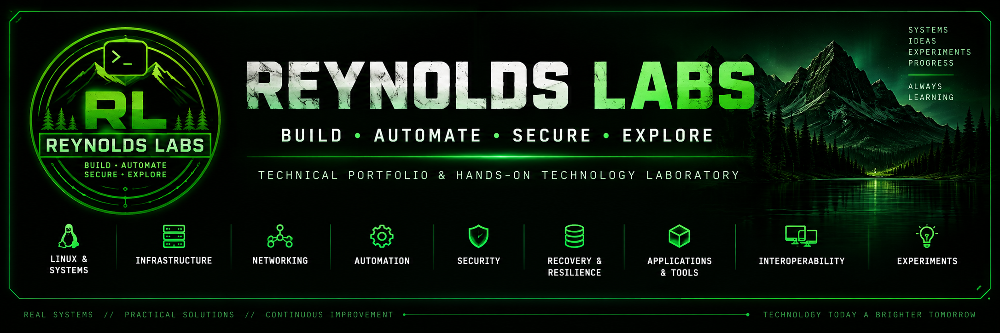

  

# REYNOLDS LABS

**BUILD • AUTOMATE • SECURE • EXPLORE**

Technical Portfolio & Hands-On Technology Laboratory

---

## About

Reynolds Labs is my technical portfolio for documenting hands-on technology projects, labs, experiments, and systems.

The portfolio focuses on demonstrating the problem or objective behind each project, how I approached it, what I built, how it was tested, and what I learned.

Projects emphasize hands-on Linux administration, infrastructure, automation, security, troubleshooting, and systems engineering.

---

## Featured Lab

### [LAB 003 — RL_Backup: Automated Backup & Recovery Manager](labs/lab003-Self-Created-Backup-Program/)

**Rocky Linux • Python • Bash • systemd • rsync • SHA-256 • PolicyKit • SELinux**

Designed and built a Linux backup and recovery manager combining automated local recovery points, external backups, integrity verification, retention, systemd scheduling, and controlled file restoration through an administrator-facing desktop application.

RL_Backup separates its non-root graphical interface from privileged operations through a restricted PolicyKit-authorized control layer. Backup integrity is validated through structural checks and SHA-256 verification rather than assuming that a successful copy is recoverable.

Final acceptance testing included automated backup execution, full integrity verification of more than 161,000 files with zero failures, simulated file deletion, and successful recovery through the graphical interface.

**Highlights:** Incremental recovery points • systemd automation • SHA-256 integrity verification • Tested file recovery • PolicyKit privilege separation • SELinux Enforcing • External backup validation • Backup profiles and retention

---

## Lab Directory

| Lab | Project | Area | Status |
|---|---|---|---|
| 001 | [Role-Based User Provisioning](labs/lab001-role-based-user-provisioning/) | Linux / Automation / Security | **Complete** |
| 002 | [Disposable Rocky Linux Workstation](labs/lab002-disposable-rocky-linux-workstation/) | Virtualization / Storage / Automation | **Complete** |
| 003 | [RL_Backup — Automated Backup & Recovery Manager](labs/lab003-Self-Created-Backup-Program/) | Linux / Backup & Recovery / Automation | **Complete** |
| 004 | [Dynamic Performance Profiles & ReTune](labs/lab004-dynamic-performance-profiles/) | Linux / Performance / Automation | **Complete** |
| 005 | [Private RPM Repository](labs/lab005-private-rpm-repository/) | Linux / Software Distribution / Security | **Complete** |

---

## LAB 001 — Role-Based User Provisioning

**Rocky Linux • Bash • SKEL • Linux Permissions • SELinux • KDE Plasma**

Built a repeatable role-based Linux onboarding system for Standard, Human Resources, and fictional Special Projects users.

Custom skeleton profiles deliver role-specific workstation resources while Linux groups and protected shared directories enforce least-privilege access. An administrator-facing provisioning workflow repeatedly creates users from standardized role templates rather than manually rebuilding each environment.

**Highlights:** Automated user provisioning • Custom SKEL profiles • Role-based access isolation • SGID shared directories • SELinux Enforcing • KDE workstation automation • Repeatability testing

[View LAB 001](labs/lab001-role-based-user-provisioning/)

---

## LAB 002 — Disposable Rocky Linux Workstation

**Rocky Linux • KVM/QEMU • libvirt • XFS • Bash • Linux Storage**

Designed and implemented a disposable Rocky Linux virtual workstation that restores its operating system to a known baseline while preserving a separate workspace for scripts, project files, and testing artifacts.

The environment separates temporary operating-system state from persistent project storage. Host-side virtualization automation prepares the disposable system disk for subsequent launches, allowing experiments to be repeated without permanently modifying the baseline environment.

Validation included creating temporary Linux accounts, installing software, modifying the graphical environment, and verifying that disposable changes were removed after a reset while files stored in the persistent XFS workspace remained available.

**Highlights:** Disposable virtual machines • KVM/QEMU virtualization • libvirt automation • Persistent XFS storage • Operating-system isolation • Reset validation • Repeatable testing environments

[View LAB 002](labs/lab002-disposable-rocky-linux-workstation/)

---

## LAB 003 — RL_Backup

**Rocky Linux • Python • Bash • systemd • rsync • SHA-256 • PolicyKit • SELinux**

Built a graphical Linux backup and recovery manager with incremental local recovery points, independent external backups, configurable retention, systemd scheduling, integrity verification, and controlled restoration.

Testing went beyond backup creation by deliberately deleting protected test data and recovering it through the finished application.

**Highlights:** Backup automation • Incremental snapshots • Full integrity verification • Recovery testing • Privilege separation • External storage validation • System rebuild support

[View LAB 003](labs/lab003-Self-Created-Backup-Program/)

---

## LAB 004 — Dynamic Performance Profiles & ReTune

**Rocky Linux • TuneD • Python • Linux Performance • systemd • PolicyKit**

Built custom Linux performance profiles and an administrator-facing utility for switching between workload-specific system tuning configurations.

The project explores operating-system performance management through TuneD while providing a simplified interface for selecting and validating workstation, performance, power-saving, and container-oriented profiles.

**Highlights:** Custom TuneD profiles • CPU performance policy • Storage tuning • Workload-specific configuration • Python GUI • Privileged profile switching • Runtime validation

[View LAB 004](labs/lab004-dynamic-performance-profiles/)

---

## LAB 005 — Private RPM Repository

**Rocky Linux • RPM • DNF • GPG • createrepo_c • Linux Permissions • SELinux**

Designed and configured a private RPM repository environment for distributing Reynolds Labs software packages, including RL_Backup and ReTune.

The repository architecture separates package development, staging, and production storage. Dedicated Linux group permissions provide controlled access to repository resources, while GPG signing establishes a mechanism for verifying package authenticity and integrity.

The lab documents repository metadata generation, signing-key management, RPM verification, repository configuration, and network connectivity testing.

The design emphasizes controlled software distribution, package trust, and repeatable repository administration without requiring public internet exposure.

**Highlights:** Private software distribution • RPM packaging infrastructure • GPG signing • Repository metadata • Group-based access controls • Package verification • Repository connectivity testing • SELinux-aware administration

[View LAB 005](labs/lab005-private-rpm-repository/)

---

## Areas of Exploration

- Linux & Systems Administration
- Infrastructure
- Automation
- Security
- Backup & Recovery
- Performance Engineering
- Networking
- Containers & Virtualization
- Software Packaging & Distribution
- Applications & Tools
- Cross-Platform Technologies
- Troubleshooting
- Technology Experiments

---

## Lab Structure

Projects are documented as technical case studies and may include:

- Problem or objective
- Project overview
- Architecture and design decisions
- Implementation concepts
- Screenshots and demonstrations
- Selected technical examples
- Testing and validation
- Troubleshooting and iteration
- Results
- Lessons learned
- Future improvements

---

## Portfolio Source Policy

### Independent Portfolio Disclaimer

Reynolds Labs is an independently developed personal technical portfolio. All projects, labs, applications, scripts, configurations, testing, experiments, and technical documentation are undertaken for my own educational purposes, professional development, and personal interests.

Reynolds Labs is not affiliated with, sponsored by, endorsed by, or operated on behalf of my current or former employers. All technical opinions, project designs, implementations, and conclusions presented here are my own and do not represent the views, policies, products, services, or business practices of any employer.

All projects are developed and tested in personally managed environments and are separate from my professional employment. No employer-owned systems, proprietary code, confidential business information, or customer data are included in this portfolio.

Reynolds Labs is a technical portfolio, not a mirror of my private development environments.

Complete project source code does not need to be publicly available for a project to be documented here. Private projects may be represented through screenshots, architecture diagrams, technical explanations, validation evidence, and carefully selected sanitized examples.

Configuration containing credentials, private data, cryptographic material, host-specific information, backup contents, or other sensitive information is excluded.

Portfolio material is manually selected and reviewed before publication.

---

## Current Development

Reynolds Labs continues to expand with projects covering Linux infrastructure, automation, administration, security, and supporting technologies.

Planned and in-progress areas include:

- Linux desktop and system utilities
- Arch-based Linux experimentation
- Notification infrastructure
- Configuration and deployment automation
- Remote administration and virtual workstation access
- Additional RL_Backup recovery and usability enhancements
- Further RPM packaging and repository automation

---

## Status

**Portfolio:** Active Development  
**Published Labs:** 5

---

**REYNOLDS LABS**

*Build • Automate • Secure • Explore*
