# LAB 002 — Disposable Rocky Linux Workstation with Persistent Workspace

**Platform:** Rocky Linux 10.2 (host and guest), KVM/QEMU, libvirt, GNOME, XFS  
**Focus:** Linux administration, virtualization, disk-image lifecycle management, Bash automation, persistent storage, and validation.

## Overview

LAB002 builds a reusable Rocky Linux graphical test workstation with two deliberately different storage behaviors: operating-system changes are disposable, while files saved under `/workspace` persist across resets.

The VM runs on a Rocky Linux host using KVM/QEMU and libvirt. A clean OS backing image and a replaceable writable overlay support repeatable resets. A separate XFS workspace volume remains attached independently of the disposable operating-system state.

The result is a practical sandbox for testing packages, accounts, desktop changes, and scripts without rebuilding the guest after each experiment.

> This repository documents the design and evidence using selected command snippets. It does **not** publish the complete VM lifecycle scripts or claim to be a turnkey installer.

## Problem

Linux experiments can leave behind packages, modified accounts, changed settings, and other configuration drift. Reinstalling a VM after every test is slow; relying on manual cleanup is inconsistent.

The goal was to automate a return to a known-good operating-system baseline **without deleting useful test files and scripts**.

## Architecture

```text
Rocky Linux 10.x host (rlabz)
         |
    KVM / QEMU / libvirt
         |
    RockyDisposable VM
         |
         +-- Operating-system disk
         |     +-- Clean golden backing image
         |     +-- Disposable writable overlay
         |            (recreated during reset)
         |
         +-- Separate persistent XFS disk
               +-- /workspace
                     +-- scripts/
                     +-- test files / evidence

Host-side lifecycle automation resets the OS overlay,
not the persistent workspace disk.
```

The reset boundary is the key design decision: the guest operating system is replaceable; the workspace is not.

## Environment

| Component | Lab implementation |
| --- | --- |
| Host | Rocky Linux 10.x, `rlabz` |
| Virtualization | KVM/QEMU, libvirt, virt-manager |
| Guest | Rocky Linux 10.2, GNOME workstation |
| VM | `Rlabz Disposal` (graphical guest shown in evidence) |
| Guest account | `dtech` |
| Guest storage | Golden QCOW2 backing image plus disposable overlay |
| Persistent storage | Separate XFS volume mounted at `/workspace` |
| Reset control | Host-side lifecycle automation |
| Network | Private libvirt lab network |

## Implementation

### 1. Create the graphical test workstation

Provisioned a Rocky Linux GNOME VM through libvirt/virt-manager. The graphical session makes it possible to test desktop configuration alongside traditional command-line administration.

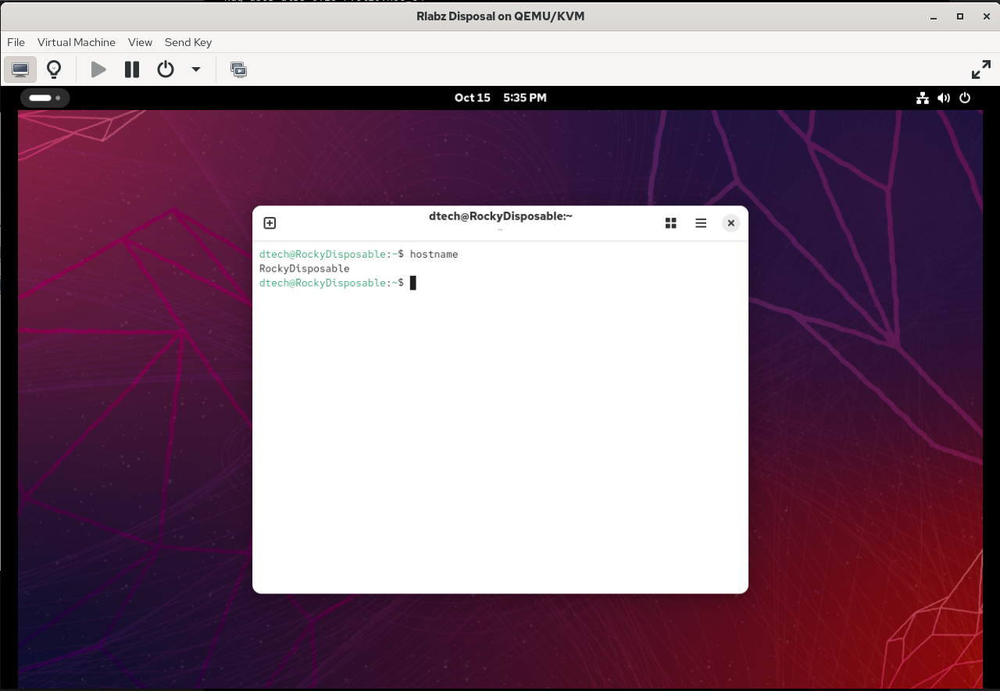

### 2. Isolate persistent project storage

Configured a separate XFS filesystem mounted at `/workspace`. The workspace holds scripts and test artifacts that must remain available after an operating-system reset.

Example verification commands:

```bash
findmnt /workspace
ls -lah /workspace
```

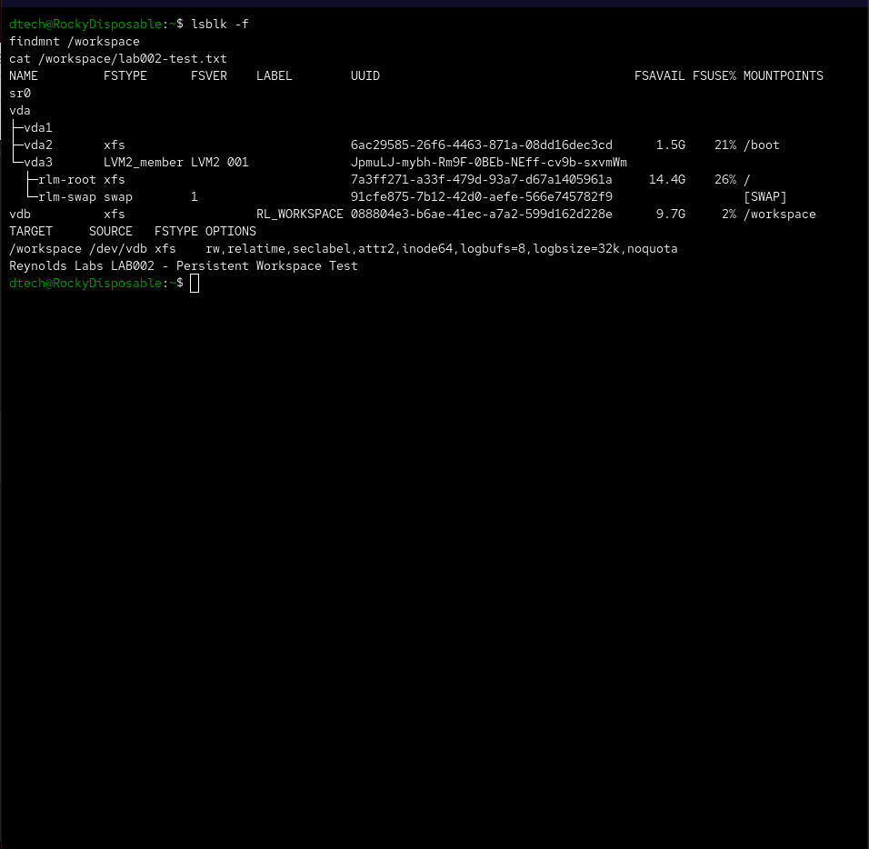

### 3. Implement a disposable OS reset

The host-side workflow maintains a known-good OS backing image and resets the writable state only when the VM is shut down. The persistent workspace disk is intentionally excluded.

A host-side lifecycle check used during validation:

```bash
virsh -c qemu:///system domstate 'Rlabz Disposal'
```

The reset logic includes safety checks to avoid replacing the wrong disk. The complete hook and image-management scripts are intentionally not included in this public case study.

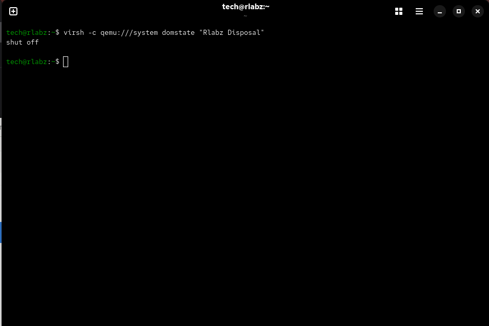

### 4. Create a persistent control file

Created a marker file on `/workspace` to distinguish data that **should survive** from changes that **should disappear**.

Example validation snippet:

```bash
cat /workspace/lab002-persistent-test.txt
```

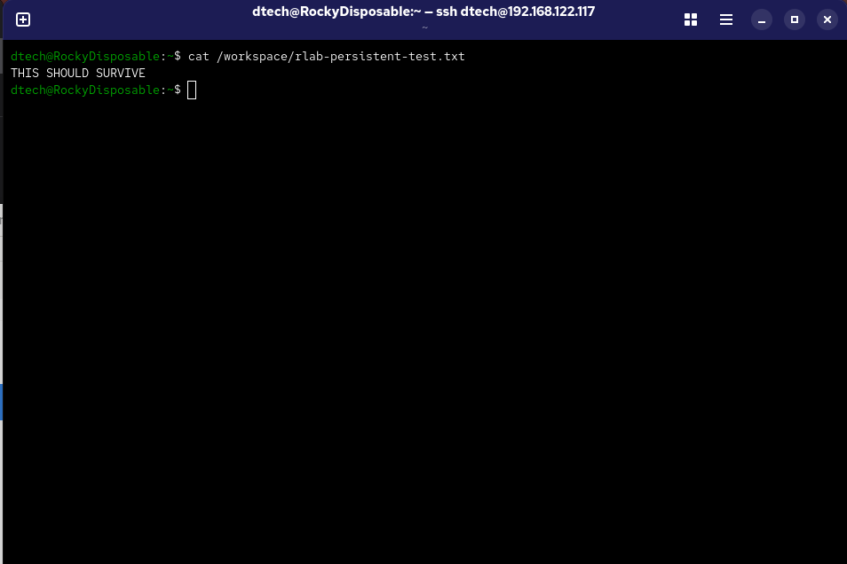

### 5. Introduce disposable OS changes

Created a temporary Linux account and made additional guest OS changes to test whether the reset returned the VM to its baseline.

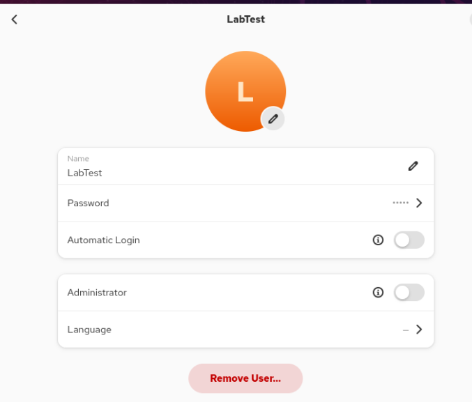

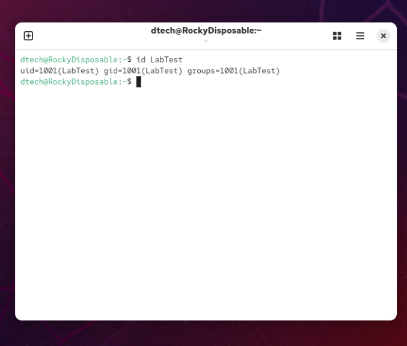

A desktop customization was also used as a visible example of mutable guest state.

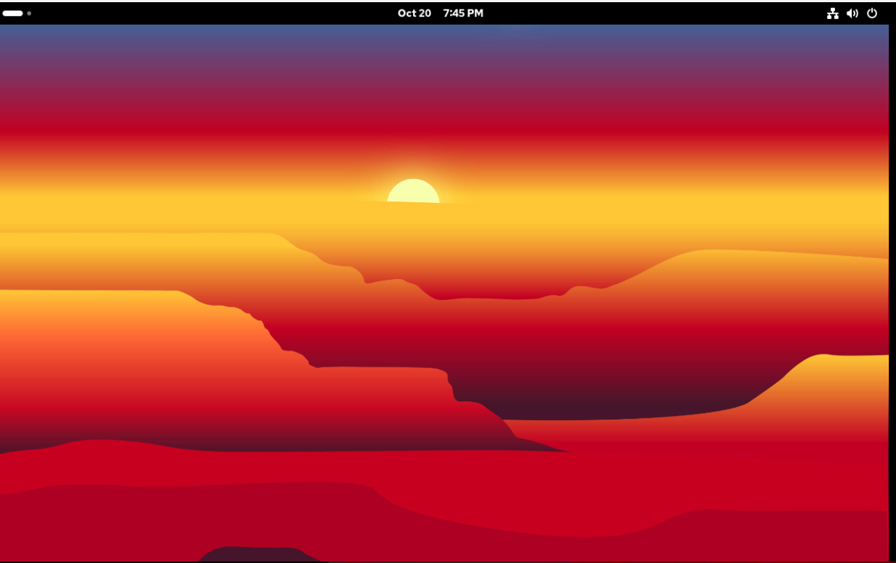

Installed a temporary test package as another OS-level change.

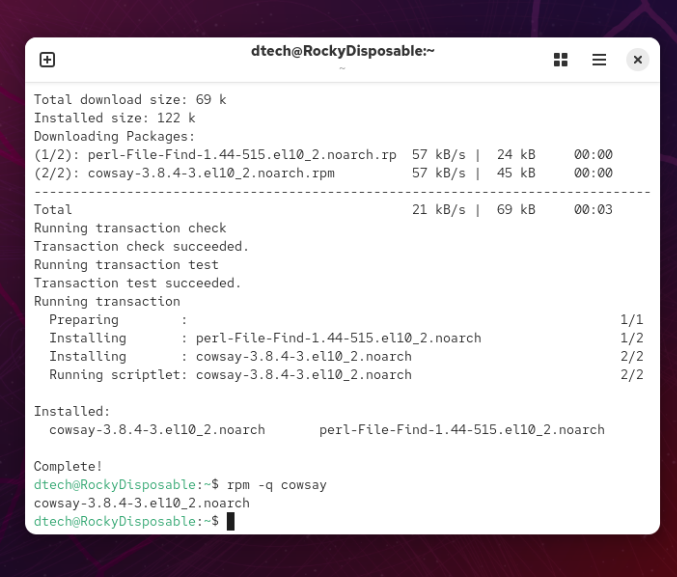

### 6. Reset and verify the outcome

After the reset, checked that the temporary account and test package were absent while the persistent workspace marker remained readable.

Example post-reset checks:

```bash
id LabTest                 # Expected: user does not exist
rpm -q cowsay             # Expected: package not installed
cat /workspace/lab002-persistent-test.txt
```

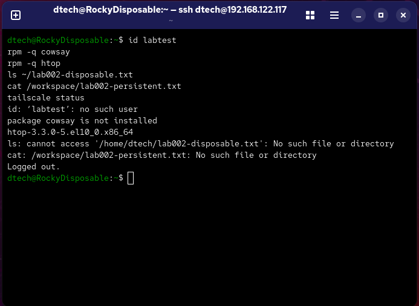

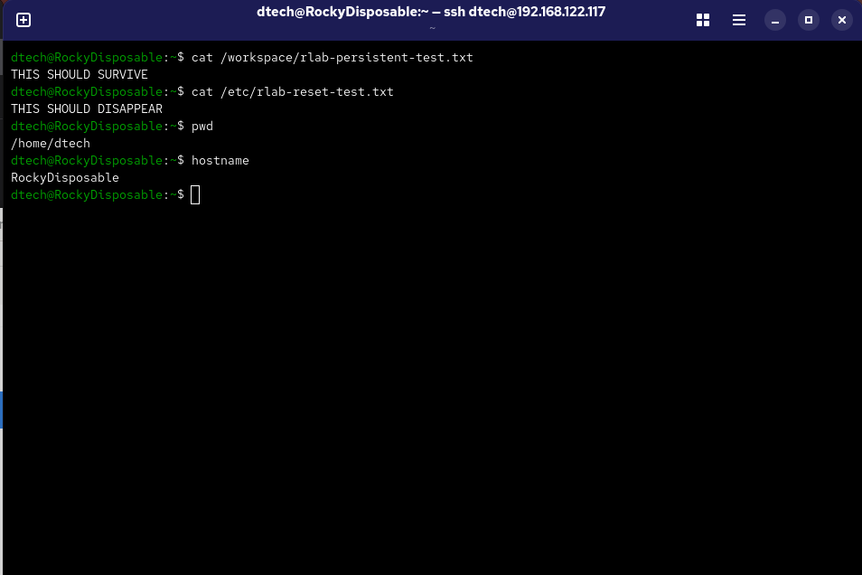

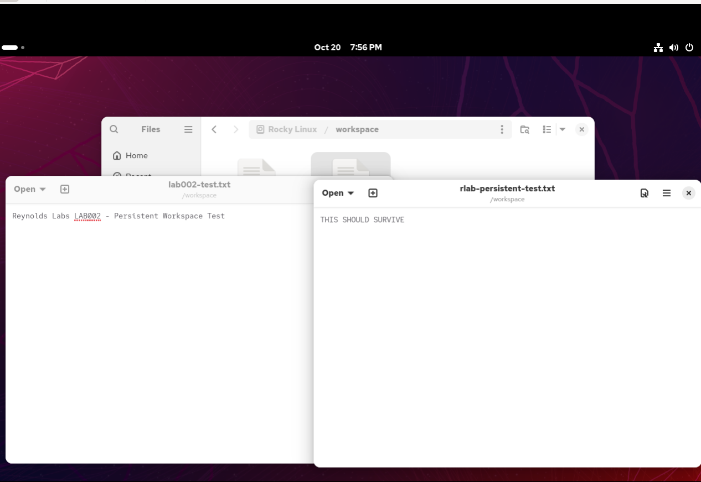

## Troubleshooting and Iteration

**Storage boundaries.** The workspace must use a separate disk from the disposable OS overlay; otherwise the reset could erase the files the lab is meant to preserve.

**Safe lifecycle handling.** A reset should not replace a live guest disk. The workflow checks VM state before discarding writable OS changes.

**Proving both outcomes.** Merely showing that a workspace file survives is not enough. The test also checks that disposable user/package changes are removed.

**Repeatability.** Because the operating system returns to baseline, any required guest setup must either be part of the golden image or be reapplied from persistent scripts.

## Validation

| Test | Expected behavior | Evidence |
| --- | --- | --- |
| Graphical VM | Rocky Linux desktop starts | Screenshot 01 |
| Workspace storage | `/workspace` is accessible | Screenshot 02 |
| VM lifecycle | Host can inspect guest state | Screenshot 03 |
| Persistent marker | Workspace file remains readable | Screenshots 04, 10, 11 |
| Temporary user | User exists during test, absent after reset | Screenshots 05, 06, 09 |
| Temporary package | Package installed for test, absent after reset | Screenshots 08, 09 |
| Desktop changes | Guest state can be modified for testing | Screenshot 07 |

**Result:** The recorded tests support a repeatable disposable OS environment with a separate persistent workspace.

## What This Lab Demonstrates

This lab demonstrates practical experience with KVM/QEMU virtualization, libvirt administration, Linux filesystems, QCOW2 backing-image concepts, automation design, safe reset boundaries, GNOME guest management, command-line verification, and evidence-based troubleshooting.

The design is intentionally lab-scale. A production implementation would add automated image versioning, verified workspace backups, reset audit logs, and more formal lifecycle controls.

## Evidence

The [`screenshots/`](screenshots/) directory contains 11 curated screenshots of the guest environment, workspace checks, temporary modifications, and reset validation.

## Disclosure

This is an independently built Reynolds Labs portfolio project. The screenshots contain lab-only hostnames, test accounts, and private-network details. No credentials, private keys, production customer information, or proprietary employer source code are intentionally included.

The complete automation source is not published; command excerpts are provided for technical context only.

---

## After Thoughts — Behind the Build

This lab came about while I was getting ready to build my Reynolds Labs portfolio. I saw the value in having a machine that I could quickly spin up, install a program or test some automation, and then shut down. The next time I started it, the operating system would reset to its original state. This ended up taking a little more work than I initially realized, especially when it came to making the reset process reliable. I also liked the idea of having persistent storage where I could keep scripts and other files. That way, I could modify the test system, run whatever experiments I wanted, and reset everything without losing the work I wanted to keep. I built this out of necessity for my home lab, and I would recommend having at least one disposable machine available for quick configuration and script testing.

I've used KVM/QEMU for virtualization and have found it reliable, with a wide range of configuration options. My biggest gripe has been getting copy and paste to work properly between my host and virtual machines. I couldn't find a straightforward way to enable it through the graphical interface I was using, so I came up with a workaround. I created a script that installs and configures what I need to access the VM remotely. I also saved the connection in Remmina. Now I can run the RDP setup script, connect through Remmina, and copy and paste works perfectly. It's a small addition, but it makes working with the disposable machine much more convenient.

The idea really started taking shape while I was designing the Reynolds Labs private RPM repository project. I knew I would need another machine to connect to the repository and test packages, but creating a new VM for every test seemed inefficient and cumbersome. The most difficult part of this lab was getting the golden image and disposable overlay working together correctly. We eventually implemented the reset through a startup script, which means the VM needs to be completely shut down and started again for the reset to take effect. I think the effort was worth it, although there are some tradeoffs. The golden image will need to be updated periodically as packages become outdated or when I want certain applications and settings to become part of the permanent baseline. This doesn't replace the need for regular persistent test machines, but it gives me a dedicated environment where I know exactly what state the operating system will return to.

I think this approach could be useful in many testing environments, especially when developing scripts or testing complete system configurations. Being able to repeat the same process against a consistent operating-system baseline has some practical advantages. I'm not sure I would make many major changes to this particular disposable VM, but I could see myself creating additional versions using distributions such as Ubuntu or Fedora. Some of my inspiration for this project came from experimenting with Qubes OS a few years ago. I always liked the concept of disposable machines, but I wanted something that offered similar convenience without some of the additional complexity that comes with Qubes OS. This project gave me a way to explore that idea using the virtualization tools I already use in my home lab.

---

## Reynolds Labs — Lab Assessment

**Technical Skill:** 2/5 — Intermediate  
**Fun Factor:** 3/5 — Enjoyable

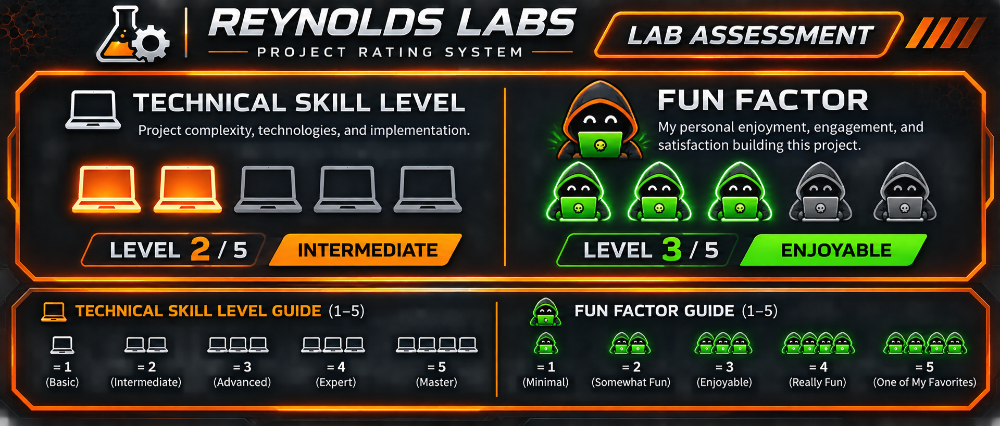
