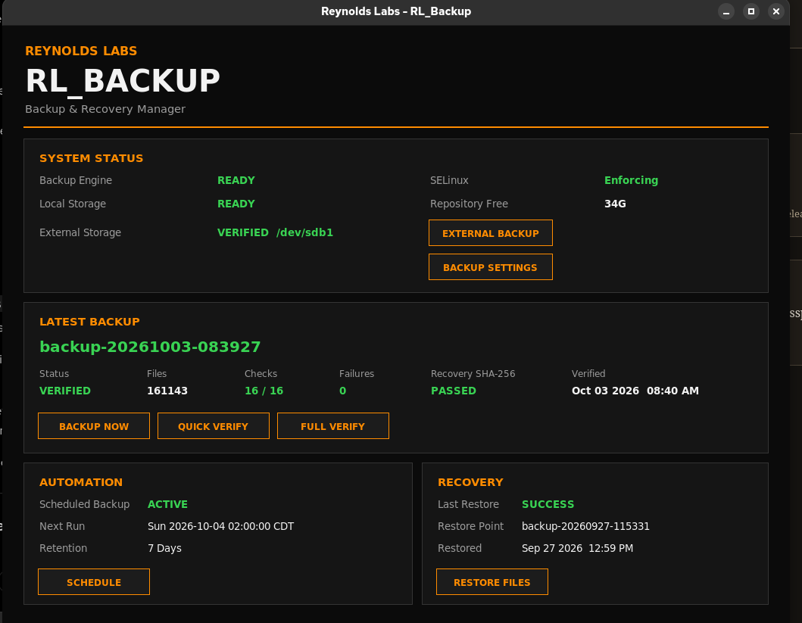
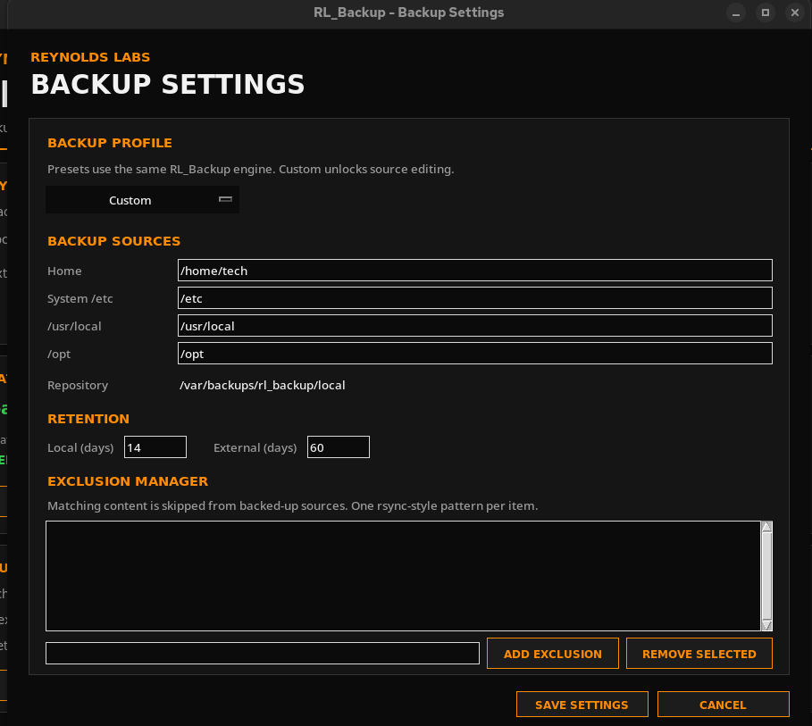
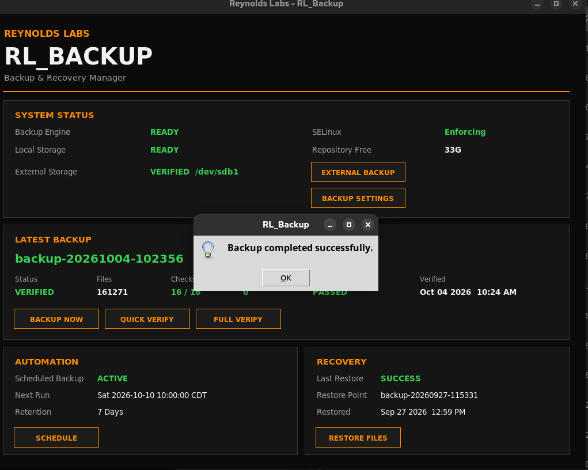
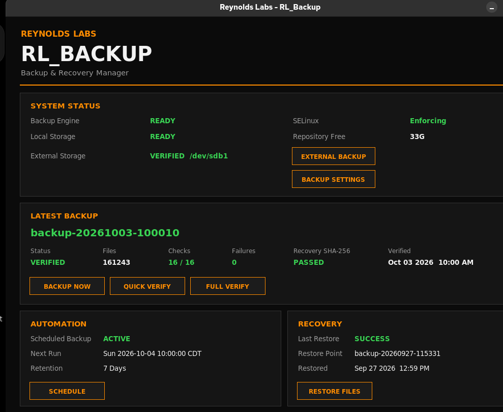
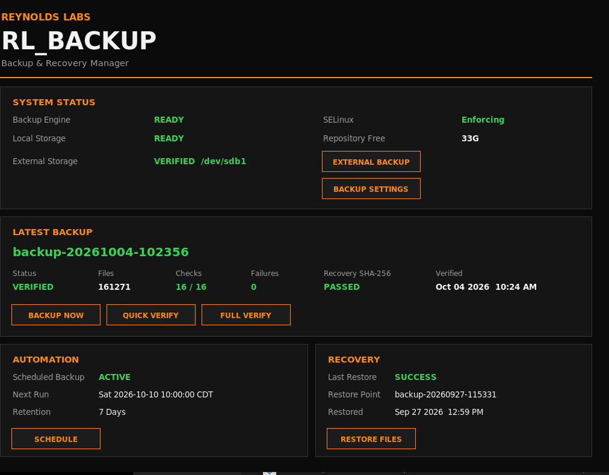
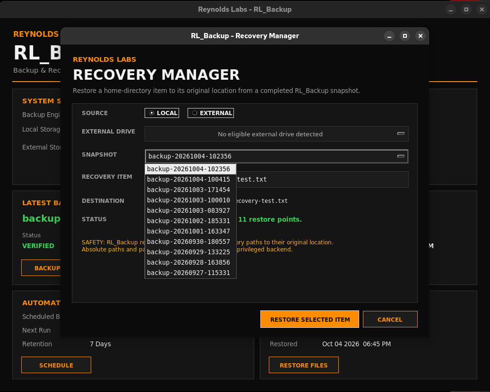
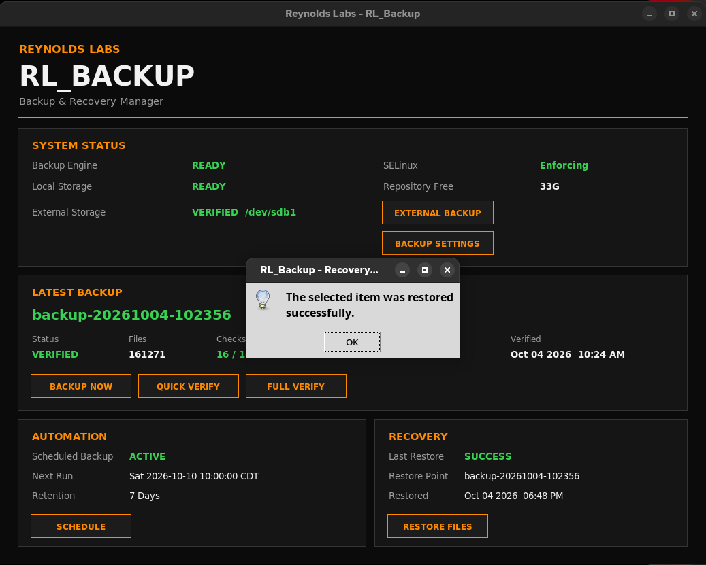
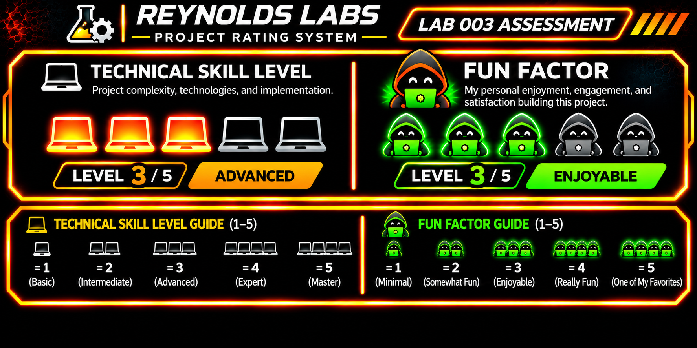

# LAB 003 — RL_Backup: Automated Backup & Recovery Manager

**Platform:** Rocky Linux 10  
**Focus:** Linux administration, backup and recovery, Bash/Python automation, systemd, rsync, SHA-256 integrity validation, privilege separation, SELinux-aware operation, and desktop application integration.

## Overview

LAB003 builds a locally managed backup and recovery system for a Rocky Linux workstation.

The project developed from a command-line backup workflow into **RL_Backup**, an administrator-facing desktop application that coordinates local recovery snapshots, external backups, integrity verification, retention, scheduling, restore operations, backup profiles, and runtime status.

The design uses a non-root graphical interface while privileged backup and recovery operations remain behind a controlled administrative helper.

RL_Backup v1.0 focuses on **file/configuration recovery and system rebuild support** rather than full-disk imaging.

---

## Problem

Important workstation data can be distributed across user files, system configuration, locally installed administrative tools, application data, and system inventory information.

Manual copies are easy to forget, difficult to validate, and often lack retention and tested recovery procedures. A successful copy alone does not demonstrate that data can actually be recovered.

The goal was to create a repeatable workflow that could:

- run manually or automatically
- maintain multiple recovery points
- validate backup integrity
- support a physically separate backup destination
- restore selected user data
- expose operational status through a desktop interface
- preserve Linux security controls rather than bypassing them

---

## Architecture

```text
                         Rocky Linux 10
                              |
                        RL_Backup GUI
                         (non-root)
                              |
                 +------------+------------+
                 |                         |
             Status Layer            Privileged Helper
                 |                      (pkexec)
                 |                         |
                 |          +--------------+--------------+
                 |          |              |              |
                 |       Backup         Verify         Restore
                 |          |              |              |
                 |          +------- Retention ------------+
                 |                         |
                 |                  Backup Repository
                 |                  /              \
                 |             Local              External
                 |          Recovery Points    Independent Copy
                 |
                 +------------ systemd ------------+
                              |
                       Scheduled Backups
                              |
                     Runtime State / Logs
```

The GUI does not run permanently as root. Administrative operations are routed through a restricted privileged control layer, while appropriate runtime metadata remains readable by the non-root interface.

---

## Backup Strategy

RL_Backup protects selected workstation locations representing user data, system configuration, locally installed tools, and application data. The source set is controlled through configuration and backup profiles.

Local recovery points use an incremental snapshot strategy. Unchanged files can be hard-linked from an earlier snapshot while changed or new data is copied into the new recovery point.

```text
Recovery Point A
├── unchanged-file
├── configuration
└── user-data

Recovery Point B
├── unchanged-file  -> hard-linked
├── configuration   -> hard-linked when unchanged
└── changed-data    -> new copy
```

This provides multiple point-in-time recovery views without treating every local snapshot as an independent full copy.

---

## Operations Dashboard

The completed interface provides a central operational view of backup health, verification state, scheduling, retention, recovery status, external storage state, and SELinux status.



---

## Backup Profiles and Exclusions

Backup profiles group protected source locations, exclusions, and retention behavior into reusable policy choices.



Disposable locations such as application caches or desktop trash can be excluded without changing the backup engine itself. This separates backup policy from implementation.

---

## Manual and Automated Backup

An administrator can initiate a backup directly from the GUI.



Completed recovery points use immutable timestamp-based identifiers. A completion marker is written only after the workflow succeeds.

Scheduled backups are delegated to **systemd services and timers** rather than an application-specific background scheduler.



The Automation Manager supports daily, weekday, weekend, weekly, and custom scheduling patterns with persistent scheduling support. Acceptance testing confirmed that a GUI-configured schedule subsequently executed a backup automatically.

---

## Integrity Verification

RL_Backup uses two levels of verification.

### Standard Verification

The normal verification workflow checks backup structure, expected components, completion state, and a controlled SHA-256 recovery test.

Acceptance testing recorded:

```text
Files:          161271
Checks Passed:  16
Checks Failed:  0
SHA-256:        PASSED
```

### Full Integrity Verification

A separate full-verification workflow generates SHA-256 information for regular files in a recovery point and independently validates the backup contents.

Final acceptance testing recorded:

```text
Full Verify Status: VERIFIED
Files Examined:     161270
Files Verified:     161270
Failures:           0
```



Integrity manifests are kept in a protected location separate from the operational metadata exposed to the desktop application.

---

## Recovery Manager

The Recovery Manager presents completed local snapshots as selectable recovery points and performs restoration through the privileged backend.



The backend validates the requested snapshot and relative recovery path before copying data back to the original user location.

For v1.0, graphical recovery is intentionally limited to protected user-home data. System configuration remains available for administrator-assisted rebuild and recovery rather than being blindly overlaid onto a running operating system.

---

## End-to-End Recovery Test

The project was not considered complete simply because backups existed.

A controlled file with a known SHA-256 fingerprint was included in a verified backup, deliberately removed from the live filesystem, and restored through the graphical Recovery Manager.

```text
Known File
    |
    v
Verified Backup
    |
    v
Live File Deleted
    |
    v
Recovery Point Selected
    |
    v
Restore Authorized
    |
    v
File Recovered
    |
    v
SHA-256 Confirmed
```



The restored file matched its expected SHA-256 fingerprint, demonstrating an end-to-end recovery path after simulated data loss.

---

## External Backup

Local recovery points provide fast restore capability but remain on the workstation's internal storage. RL_Backup therefore also supports a physically separate external repository.

Before writing to an external destination, the backend validates mount state, write access, supported filesystem type, minimum capacity, and device identity. The workstation's internal system disk is rejected as an external destination.

A successfully validated external backup recorded:

```text
External Status:     VERIFIED
Filesystem:          ext4
SHA-256 Status:      PASSED
External Retention:  30 days
```

Later testing identified USB/device instability and filesystem journal errors on the removable test drive. Further writes were intentionally stopped rather than bypassing the storage failure. Previously completed and verified external-backup evidence remained valid.

This distinction keeps **application health** separate from **storage-device health**.

---

## Retention

Configurable retention prevents recovery points from accumulating indefinitely.

The acceptance configuration used:

```text
Local retention:    7 days
External retention: 30 days
```

Retention operates against completed recovery points while protecting the newest backup.

---

## System Rebuild Support

In addition to protected files, RL_Backup records system inventory information useful during workstation reconstruction, including package, repository, storage, filesystem, OS release, kernel, SELinux, and application inventory data.

The intended larger-failure recovery model is:

```text
Hardware / OS Failure
        |
        v
Reinstall Rocky Linux
        |
        v
Reinstall RL_Backup
        |
        v
Reference System Inventories
        |
        v
Rebuild Configuration
        |
        v
Restore Protected User Data
```

RL_Backup is positioned as **system rebuild support**, not bare-metal disaster recovery or full-machine imaging.

---

## Privilege Separation

The graphical application operates as the desktop user. Privileged operations are authorized through PolicyKit and passed to a restricted control helper.

A simplified representation of the interface boundary:

```python
command = [
    "/usr/bin/pkexec",
    "/usr/local/sbin/rl-backup-control",
    action,
]
```

The privileged helper accepts defined operations rather than arbitrary shell commands. The backend performs its own validation even when an operation originates from the GUI.

A deliberately limited example is included in `snippets/privilege-separation.py`.

---

## Restore Safety

Recovery input is validated at the privileged backend rather than trusting the GUI alone.

A simplified example:

```bash
[[ "$snapshot" =~ ^backup-[0-9]{8}-[0-9]{6}$ ]] || exit 1
[[ "$item" != /* ]] || exit 1
[[ "$item" != *".."* ]] || exit 1
```

The production implementation performs additional validation before restoration is permitted.

---

## SELinux and Runtime Security

SELinux remained **Enforcing** throughout development and acceptance testing.

Protected configuration, privileged engines, and integrity manifests retain restrictive permissions. Appropriate operational metadata is separated so the non-root GUI can report health without weakening protected state.

Administrative operations also integrate with system logging for review outside the GUI.

---

## Troubleshooting and Iteration

Several failures discovered during development materially improved the design.

**Privilege-separated status.** Early status reporting depended on protected configuration that a normal desktop user could not read. Operational state was separated from privileged configuration instead of weakening configuration permissions.

**Runtime validation.** Syntax validation alone did not guarantee that every required Python symbol existed at runtime. Runtime smoke testing was added to the acceptance process.

**Privileged control validation.** Acceptance testing exposed a missing service variable in the control layer before the manual GUI backup was accepted as complete.

**Verification permissions.** Full verification initially restricted the parent state directory too aggressively. Public operational metadata and protected integrity manifests were separated.

**Recovery-point discovery.** The initial recovery workflow required manual snapshot entry. Completed recovery points were later discovered through the controlled backend and exposed through a GUI selector.

**External storage failure.** USB disconnects and filesystem journal errors were treated as a storage-device failure rather than bypassed to obtain a successful demonstration.

These iterations moved the project from a collection of scripts toward a clearer separation of interface, policy, privileged execution, state, verification, and recovery.

---

## Validation

LAB003 validated:

- manual GUI backup creation
- incremental local recovery points
- automatic systemd backup execution
- persistent scheduling
- backup profiles and exclusions
- configurable retention
- local recovery-point discovery
- controlled restore authorization
- simulated file deletion
- successful graphical file recovery
- SHA-256 validation of restored data
- standard backup verification
- full integrity verification
- 161,270 files verified with zero failures
- external backup creation and verification
- external-device safety validation
- internal-disk rejection
- protected verification manifests
- non-root operational status
- privilege-separated administrative actions
- SELinux Enforcing operation

---

## What This Lab Demonstrates

This project demonstrates practical experience with Linux backup and recovery design, Bash and Python automation, rsync, hard-linked incremental snapshots, SHA-256 integrity validation, systemd services and timers, PolicyKit privilege separation, filesystem permissions, removable-storage validation, SELinux-aware administration, desktop application integration, troubleshooting, recovery testing, and technical documentation.

It also demonstrates the operational distinction between **creating backups** and **proving recovery**. Scheduled execution, integrity validation, simulated data loss, and actual restoration were tested before the v1.0 design was frozen.

---

## Scope and Limitations

RL_Backup v1.0 is a lab-scale Linux workstation backup and recovery manager.

It is not presented as:

- a bare-metal imaging system
- an enterprise backup product
- a replacement for off-site backup infrastructure
- an application-consistent database backup system

Live databases require application-aware backup methods rather than assuming that copying active database files creates a consistent recovery point.

---

## Future Improvements — LAB003.1

The frozen v1.0 backend provides a baseline for a future usability and recovery enhancement phase.

Planned areas include:

- graphical backup file browser
- recovery search
- friendly backup labels while preserving immutable snapshot IDs
- backup history interface
- progress indicators for long-running operations
- clearer removable-drive states
- additional recovery workflow improvements
- future database-aware backup providers

---

## Evidence

The `screenshots/` directory contains the curated operational and validation evidence used in this case study.

Only selected screenshots and small sanitized implementation excerpts are published. The complete application source, host configuration, backup contents, integrity manifests, runtime state, rollback copies, and private system data are intentionally excluded from this public portfolio.

---

## Disclosure

This is an independently built Reynolds Labs portfolio project running in a personal lab environment.

Screenshots and technical evidence are curated to avoid exposing private backup contents, credentials, cryptographic material, or unrelated personal data.

No proprietary employer code, customer information, production credentials, or employer systems are included.

---

## After Thoughts — Behind the Build

This lab was more ambitious in scope than some of my previous projects. While researching backup options for my Rocky Linux environment, I started wondering what it would take to build my own backup utility. Originally, I had planned to include database backup capabilities, specifically for SQL and PostgreSQL databases. As development progressed, I realized the project was becoming larger than I initially anticipated, so I decided to scale it back and focus on file-level backups. I may revisit database backups in a future Reynolds Labs project. My main inspiration was wanting to design a software utility specifically for Rocky Linux that could eventually become part of a larger collection of tools I build for my own systems. Some of the most difficult parts were implementing automatic discovery of external backup storage and getting the backup verification and checksum processes working reliably.

One of the biggest challenges was transitioning from working terminal-based backup and restore scripts into a graphical application. The underlying functions were already working, but building the GUI required implementing each button individually and repeatedly testing to make sure I hadn't broken the original functionality. Configuring the external backup functionality also took additional time. In my opinion, a backup solution needs to support storing copies somewhere other than the primary system. Once the external destination is configured, however, the process becomes much simpler: run the backup, and the application handles the configured destinations. Surprisingly, the restoration process went more smoothly than getting the initial graphical interface working. My favorite part of the finished application was the GUI itself and the ability to simply type `rl_backup` in a terminal to launch it. No desktop icon required, just a simple command that fits into the Reynolds Labs software suite I'm building.

This project required a considerable amount of work up front, and there were moments when I wondered whether I would ever finish it or get everything working correctly. At one point, I was worried I wouldn't get the backup functionality right, and I even questioned whether the project was worth completing without the database backup features I had originally envisioned. I kept working through the problems, though, and when I finally completed my first successful backup and restore test, I shouted across the house, "I did it!!!!!" I could hear my daughters in the other room saying, "Dad solved a tech thing. He's cheering again!" That moment made all the troubleshooting worthwhile. Of the first five Reynolds Labs projects, this one probably took the longest to complete, but it was also one of the most rewarding.

Looking back, one of the biggest lessons was understanding the importance of verification. Creating a backup is one thing, but being able to verify its integrity and successfully restore files is what gives the process real value. I learned quite a bit about developing a Linux application, integrating scripts with a graphical interface, and working through a project that turned out to be more complicated than expected. RL_Backup also fits into my larger goal of building a Rocky Linux environment with a suite of custom tools designed for my own lab systems. Would I build this particular project again from scratch? Probably not! It was a lot of work, and I wouldn't be eager to repeat the entire process. But I appreciate the experience, everything I learned along the way, and the fact that I now have a homemade file backup utility that I can continue improving.

---

## Reynolds Labs — Lab Assessment

**Technical Skill:** 3/5 — Advanced  
**Fun Factor:** 3/5 — Enjoyable


