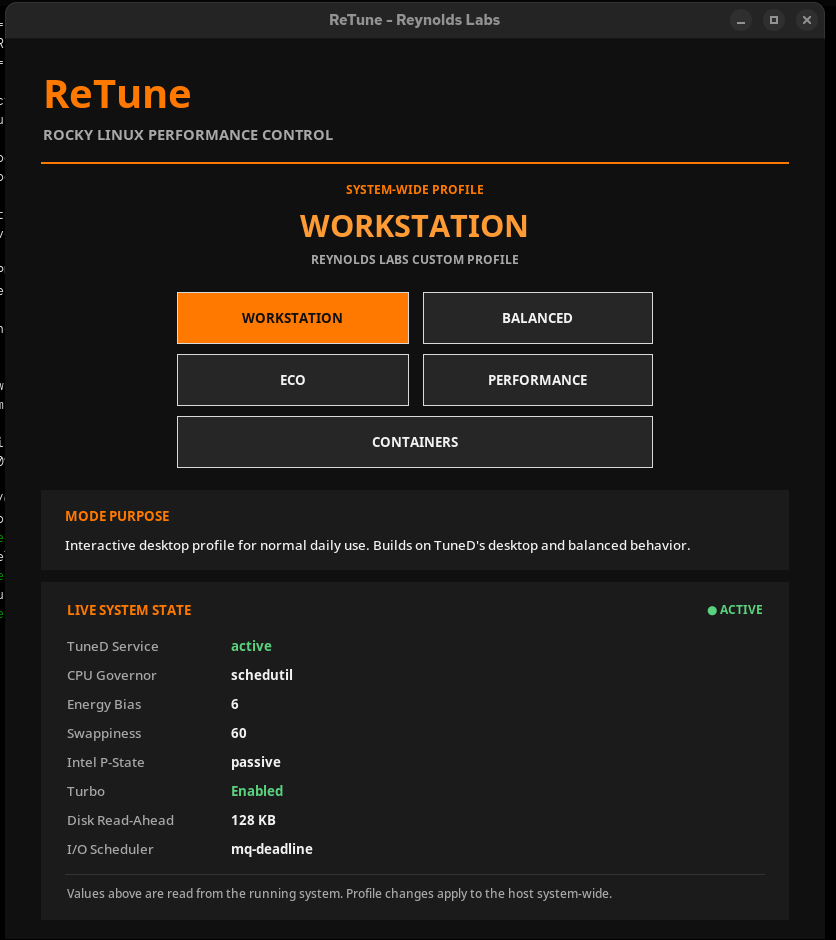
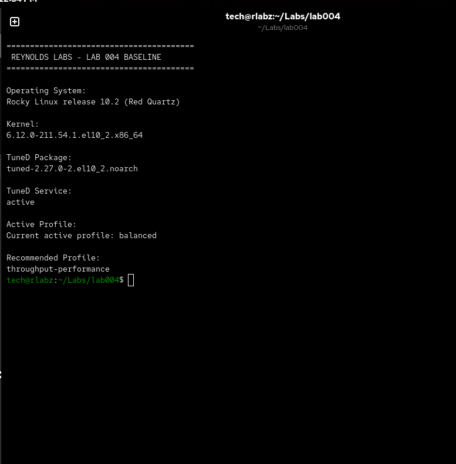
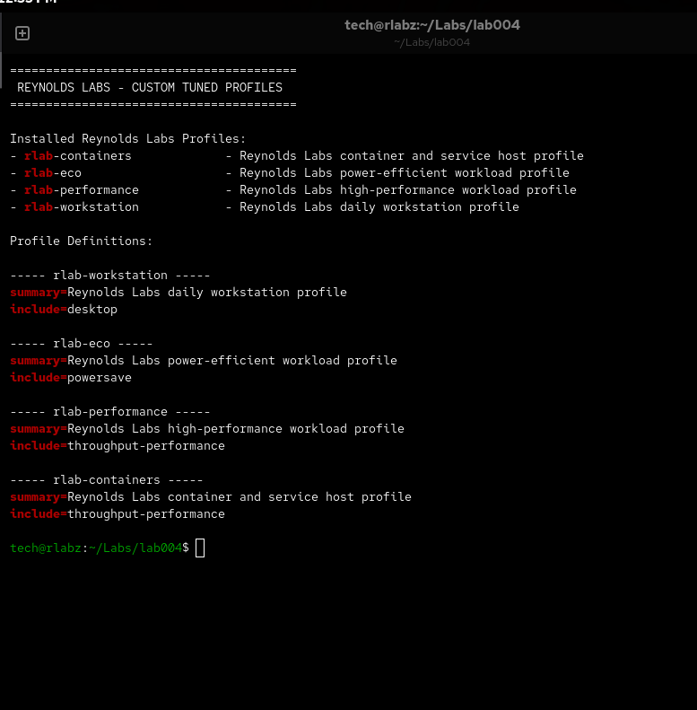
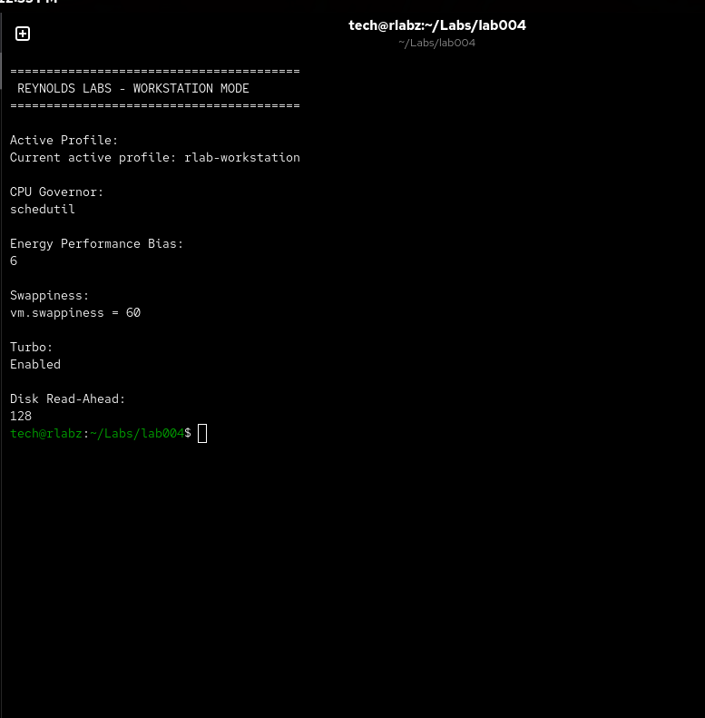
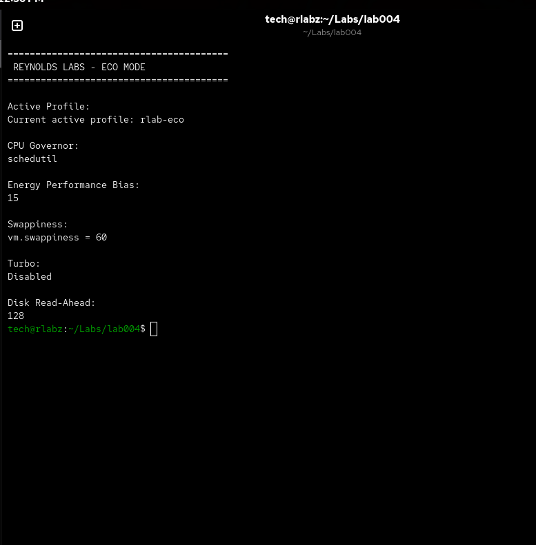
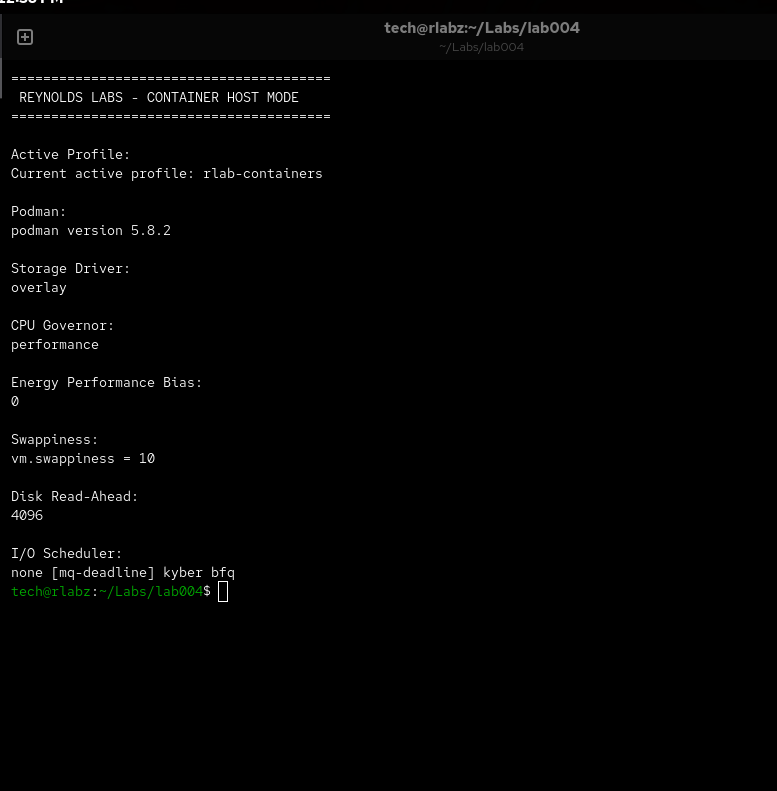
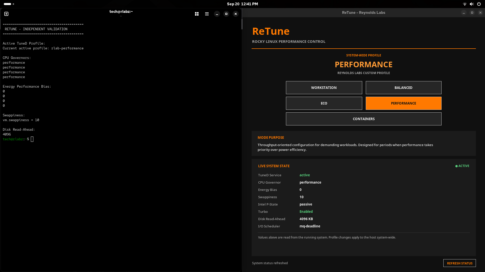
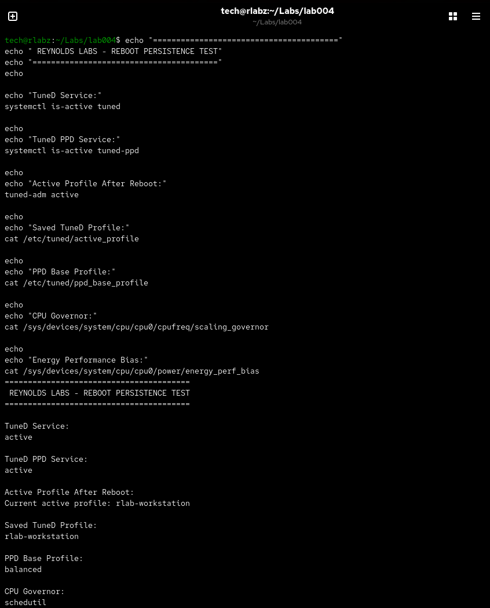
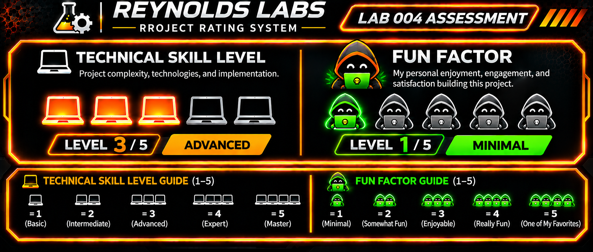

# Lab 004 — Dynamic Performance Profiles with RHEL TuneD

> **Reynolds Labs** · Rocky Linux 10.2 · TuneD · Python/Tkinter · PolicyKit · GNOME/PPD Integration

A system-performance administration lab that builds workload-specific TuneD profiles and a small desktop controller, **ReTune**, for switching between them safely. The project also documents a real boot-persistence issue caused by the interaction between custom TuneD profiles and Rocky Linux desktop power-profile integration, then resolves it without disabling that integration.



## The Problem

A general-purpose Linux workstation can move between very different workloads: interactive desktop use, low-power operation, demanding compute work, and periods where the host primarily runs containers or services. A single performance policy does not communicate those operational intentions well.

The challenge was to create understandable workload modes while keeping the implementation supportable and reversible. The lab deliberately avoids arbitrary kernel tuning, disabling SELinux, filesystem changes, and unsupported performance claims.

## The Goal

Build a Rocky Linux performance-profile system that:

- uses TuneD as the system-level tuning engine;
- provides clearly named workload profiles rather than unexplained individual tweaks;
- exposes live system state so profile changes can be independently verified;
- allows profile changes from a non-root GUI through a constrained privilege boundary;
- coexists with Rocky Linux desktop power-profile integration; and
- persists the intended profile across reboot.

## Environment

| Component | Lab system |
|---|---|
| OS | Rocky Linux 10.2 (Red Quartz) |
| Kernel | 6.12.0-211.54.1.el10_2.x86_64 |
| TuneD | 2.27.0-2.el10_2 |
| CPU | Intel Core i5-4570T, 2 cores / 4 threads |
| Memory | 15 GiB |
| Virtualization | Bare metal |
| Desktop integration | `tuned-ppd` |

The original TuneD profile was `balanced`. A copy of the captured baseline is included in [`evidence/host-baseline.txt`](evidence/host-baseline.txt).



## Solution Architecture

```text
                         ReTune GUI
                    Python 3 + Tkinter
                           |
             reads live state | requests change
                           |
                           v
                        pkexec
                           |
                 PolicyKit authentication
                           |
                           v
              /usr/local/sbin/retune-switch
                 root-owned allowlisted helper
                           |
                           v
                       tuned-adm
                           |
              +------------+------------+
              |            |            |
              v            v            v
         Workstation      Eco      Performance
              |            |            |
            desktop     powersave   throughput-
              |                      performance
              +------------+------------+
                           |
                           v
                         TuneD

GNOME / PPD ----> tuned-ppd ----> TuneD profile mapping

Additional ReTune modes:
  Balanced   -> stock TuneD balanced
  Containers -> rlab-containers -> throughput-performance
```

ReTune is intentionally a controller **over TuneD**, not a replacement for TuneD.

## Profile Design

The custom profiles inherit from established TuneD profiles instead of duplicating or inventing low-level settings.

| ReTune mode | TuneD profile | Parent | Intended use |
|---|---|---|---|
| Workstation | `rlab-workstation` | `desktop` | Daily interactive desktop work |
| Balanced | `balanced` | Stock profile | General-purpose baseline |
| Eco | `rlab-eco` | `powersave` | Light/idle use with energy savings |
| Performance | `rlab-performance` | `throughput-performance` | Demanding throughput-oriented workloads |
| Containers | `rlab-containers` | `throughput-performance` | Host primarily running containers/services |

The Containers and Performance modes intentionally share the same parent profile. The project does not claim that the Containers label changes Podman itself; it provides an explicit host operating mode using TuneD's supported throughput-oriented policy.



### Example: profile inheritance

```ini
[main]
summary=Reynolds Labs daily workstation profile
include=desktop
```

The small TuneD profile definitions used by the lab are included in [`profiles/`](profiles/). ReTune application source is intentionally not published; selected implementation excerpts are provided in [`snippets/`](snippets/).

## Measured Profile State

The profiles were activated and the resulting host state was read back from TuneD, sysfs, and sysctl interfaces.

| Mode | CPU governor | Energy bias | Swappiness | Turbo | Read-ahead |
|---|---|---:|---:|---|---:|
| Balanced | `schedutil` | 6 | 60 | Enabled | 128 KB |
| Workstation | `schedutil` | 6 | 60 | Enabled | 128 KB |
| Eco | `schedutil` | 15 | 60 | Disabled | 128 KB |
| Performance | `performance` | 0 | 10 | Enabled | 4096 KB |
| Containers | `performance` | 0 | 10 | Enabled | 4096 KB |

Workstation and Balanced expose similar values in this snapshot because `rlab-workstation` inherits TuneD's `desktop` profile, which itself builds on balanced behavior. The desktop profile also enables scheduler autogrouping for interactive workloads.

### Workstation



### Eco



### Performance


### Container Host



## ReTune GUI

ReTune provides a simple interface for selecting the five operating modes and viewing the live state of the host. It reports:

- active TuneD profile;
- TuneD service state;
- CPU governor;
- energy-performance bias;
- swappiness;
- Intel P-State mode;
- turbo state;
- disk read-ahead; and
- active I/O scheduler.

The GUI runs as the normal desktop user. It does **not** run as root.

The ReTune interface is shown at the beginning of this README; the following sections document its underlying controls and validation.

## Privilege and Security Design

Profile switching crosses a deliberately narrow privilege boundary:

```text
ReTune -> pkexec -> PolicyKit -> retune-switch -> tuned-adm
```

The helper accepts only five predefined arguments. Arbitrary TuneD profile names or shell commands cannot be supplied through the GUI.

```bash
case "${1:-}" in
    workstation) PROFILE="rlab-workstation" ;;
    balanced)    PROFILE="balanced" ;;
    eco)         PROFILE="rlab-eco" ;;
    performance) PROFILE="rlab-performance" ;;
    containers)  PROFILE="rlab-containers" ;;
    *)
        echo "ReTune: invalid profile request." >&2
        exit 2
        ;;
esac
```

The installed helper was owned by root and invoked with `pkexec`; the project did not add a broad passwordless sudo rule.

## Independent Validation

A GUI indication alone was not treated as proof that a profile was active. ReTune's Performance mode was compared with independent terminal reads of the active TuneD profile, CPU governors, energy bias, swappiness, and disk read-ahead.



## Troubleshooting: TuneD Verification

During the lab, `tuned-adm verify` reported that the running system differed from the preset profile even while the stock `balanced` profile was active. Investigation showed host-specific verification mismatches around CPU-frequency/turbo interfaces, including a conservative governor compiled into the kernel rather than appearing as a loadable module and a generic boost interface not exposed on this host.

Because the same verification behavior existed under the stock profile, the lab did not hide the result or compensate with arbitrary sysctl changes. Instead, profile behavior was validated through the specific live interfaces relevant to each tested setting.

This was an important distinction: a failed aggregate verification command was treated as a troubleshooting signal, not automatically as evidence that the custom profiles were broken.

## Troubleshooting: Reboot Persistence and `tuned-ppd`

The first persistence test exposed a second issue. `rlab-workstation` was active and stored in `/etc/tuned/active_profile` before reboot, but the machine returned to the stock `balanced` profile after boot.

Investigation found that this Rocky Linux desktop also runs `tuned-ppd`, the Power Profiles Daemon compatibility layer. Its original configuration mapped the desktop's three power modes to stock TuneD profiles:

```ini
power-saver=powersave
balanced=balanced
performance=throughput-performance
```

Rather than disabling desktop power-profile integration, the configuration was backed up and ReTune was integrated with it:

```ini
[profiles]
power-saver=rlab-eco
balanced=rlab-workstation
performance=rlab-performance
```

The stock `balanced` mode and the ReTune-only Containers mode remain directly selectable in ReTune. The PPD mapping handles the three desktop-facing power modes.

After the integration change, a controlled reboot confirmed that `rlab-workstation` remained both the active and saved TuneD profile while `tuned` and `tuned-ppd` were active.



## Rollback Strategy

This lab was performed on a real workstation, so rollback was designed before changing the PPD integration. The repository includes reference copies of the original profile state and PPD configuration in [`reference/`](reference/).

The rollback plan is:

1. restore the original `/etc/tuned/ppd.conf` mapping;
2. restore the original TuneD profile (`balanced` on this host);
3. remove only the `rlab-*` profiles from `/etc/tuned/profiles/`;
4. remove the installed ReTune privileged helper/launcher if present; and
5. restart TuneD/`tuned-ppd` and verify the stock profile.

The source repository, evidence, and screenshots are intentionally separate from operational files so cleanup of the installed system does not destroy the lab record.

## Results

The completed lab produced four custom workload profiles, retained the stock Balanced option, and added a desktop controller that exposes the host's live performance state. Profile changes were independently validated, privilege escalation was constrained to an allowlisted helper, and reboot persistence was tested rather than assumed.

The most valuable outcome was the integration work. The first design switched TuneD correctly during the session but did not survive reboot because another system component participated in profile selection. Tracing that behavior to `tuned-ppd` and designing around it produced a more realistic system-administration exercise than simply creating several `tuned.conf` files.

## What I Learned

- TuneD profiles are most maintainable when they inherit from supported workload profiles rather than duplicating low-level settings.
- A profile name should describe operational intent; it should not imply benchmark gains that were never measured.
- GUI state is not sufficient validation for a system-management tool. The underlying kernel/sysctl state should be checked independently.
- Desktop power-management integration can affect TuneD state across boot even when direct `tuned-adm` switching works correctly during a session.
- Preserving and integrating with an existing service can be safer than disabling it simply to make a custom tool behave as expected.
- Privileged desktop utilities can keep their UI unprivileged by placing a small, constrained operation behind PolicyKit.

## Repository Layout

```text
lab004-dynamic-performance-profiles/
├── README.md
├── evidence/
│   ├── host-baseline.txt
│   └── profile-state captures
├── profiles/
│   ├── rlab-workstation.conf
│   ├── rlab-eco.conf
│   ├── rlab-performance.conf
│   └── rlab-containers.conf
├── reference/
│   └── original pre-change state/configuration
├── snippets/
│   ├── retune-security-snippet.md
│   ├── retune-status-snippet.md
│   └── ppd-integration-snippet.md
└── screenshots/
    └── 01–09 portfolio evidence
```

### Source Publication Policy

This portfolio entry documents the architecture, implementation decisions, validation evidence,
configuration, and selected code excerpts needed to demonstrate the work. The complete ReTune
application source is intentionally kept private.

## Scope

This project demonstrates Linux performance-profile administration and integration on the documented lab host. The observed values are specific to that hardware and workload state. It is not presented as a benchmark, and the profiles are not claimed to improve every workload.

---

**Reynolds Labs**  
*Build · Automate · Secure · Explore*

---

## After Thoughts — Behind the Build

This lab came out of brainstorming ideas for Reynolds Labs. I eventually settled on performance optimization because I had never really worked with Linux optimization utilities before. Since I already had a Rocky Linux host system, I thought there would be value in learning how performance profiles work and how they could be used for different workloads. Linux already provides tools and predefined profiles that can be managed through terminal commands, but I wanted to take that functionality and make it more accessible. I decided to create a graphical interface that would let someone launch ReTune with a simple command and select a performance mode without needing to remember the underlying commands. Once the application was finished, I realized it would also make a good addition to the larger Reynolds Labs software suite I'm gradually building.

I developed ReTune using Python and Tkinter. The graphical interface was a fairly straightforward choice because I've already built a few smaller applications using these tools, and I'm becoming more comfortable working with them. The biggest challenge wasn't creating the interface or switching between profiles; it was getting the selected performance mode to remain active after rebooting the system. Initially, everything appeared to work correctly, but after restarting Rocky Linux, the system would revert to its previous settings. I suspected something was restoring the original system state, and after investigating, I discovered that another service was overriding the selected profile during startup. Resolving that issue was easily the most difficult part of the project and reinforced the importance of testing configuration changes across reboots rather than assuming that a setting will remain active.

The original scope of this lab was relatively simple: build a graphical utility for people who might not know how to configure Linux performance profiles through the terminal. While working on it, I gained a new appreciation for TuneD and PolicyKit, particularly how they can be used together to provide a graphical interface without requiring the entire application to run with administrator privileges. ReTune is another example of taking existing Linux functionality and making it easier to manage through a small utility. I could also see pairing it with my disposable workstation project or other test environments, allowing different Rocky Linux systems to be configured for particular workloads.

Would this be an essential tool for an experienced Linux administrator? Probably not. Someone comfortable with the terminal could accomplish the same basic tasks using TuneD commands. However, I still think there's value in having a simple interface that makes selecting and viewing performance modes more convenient. If I revisited this project, I would probably expand the available tuning modes and experiment with more advanced, fine-grained performance settings. Overall, this was one of my simpler Reynolds Labs projects. TuneD already did most of the heavy lifting, and my main contribution was building a graphical controller around it. It wasn't one of my most exciting projects, but it gave me useful experience with Linux performance management and another application to add to my growing collection of tools.

---

## Reynolds Labs — Lab Assessment

**Technical Skill:** 3/5 — Advanced  
**Fun Factor:** 1/5 — Minimal


