# LAB 005 — Private RPM Repository with Package Signing

**Platform:** Rocky Linux 10  
**Focus:** RPM packaging and distribution, DNF repositories, GPG signing, Linux filesystem administration, group permissions, repository metadata, network troubleshooting, and validation.

## Overview

LAB005 builds a privately administered RPM repository for distributing Reynolds Labs utilities across Rocky Linux systems. The repository supports internal tools such as **RL_Backup** and **ReTune**, while separating package preparation from the production repository and establishing a signing identity for package verification.

The project combines repository directory design, delegated group permissions, RPM metadata generation, cryptographic signing, client-side installation, and troubleshooting.

A disposable Rocky Linux workstation from LAB002 was used to connect to the repository through a private VPN. Both RL_Backup and ReTune were successfully installed using DNF, launched, and checked for basic functionality.

The lab uses internal systems and test data; it is **not presented as a public software distribution service**.

> **Scope:** The screenshots document repository setup, signing identity, package-related tooling, and network tests. Successful DNF installation and basic application testing were also completed. The project does not claim a fully automated release pipeline, comprehensive application testing, or a production rollout to multiple client machines.

## Problem

Linux utilities maintained outside a standard vendor repository can be difficult to deploy consistently. Copying scripts manually between machines introduces version drift, inconsistent permissions, and uncertain provenance.

A private RPM repository offers a more manageable distribution path: packages can be built and staged, published with repository metadata, checked for integrity and signatures, and retrieved using familiar RPM/DNF tooling.

## Goal

Create a functional, controlled internal package distribution service that:

- Organizes build, staging, and production areas separately.
- Supports RPM packages for Reynolds Labs utilities.
- Uses an identifiable GPG signing key for RPM authenticity checks.
- Generates repository metadata that DNF-compatible clients can consume.
- Keeps repository administration separate from unrestricted public publishing.
- Supports private network connectivity between the repository host and client systems.
- Allows custom Reynolds Labs applications to be installed using DNF.
- Produces evidence of permissions, configuration, signing, and connectivity testing.

## Architecture

```text
                       Rocky Linux 10 Host
                               |
                   Reynolds Labs RPM Workflow
                               |
               +---------------+---------------+
               |               |               |
          Build Area       Staging Area    Signing Identity
               |               |               |
               +------- review / signing ------+
                               |
                      Production Repository
                               |
                       Packages/ + repodata/
                               |
                       Private Network Access
                               |
                          Tailscale VPN
                               |
                      LAB002 Disposable VM
                               |
                         DNF Installation
                               |
                       RL_Backup / ReTune
```

The lab uses these host-side locations:

```text
/opt/reynolds-labs/repository/build/
/opt/reynolds-labs/repository/staging/packages/
/srv/reynolds-labs/repository/production/
/srv/reynolds-labs/repository/keys/
/etc/reynolds-labs/repository/repository.conf
/var/log/reynolds-labs/
```

Build and staging paths are separate from the production publication tree. The production area contains the package payloads and generated `repodata` used by RPM repository clients.

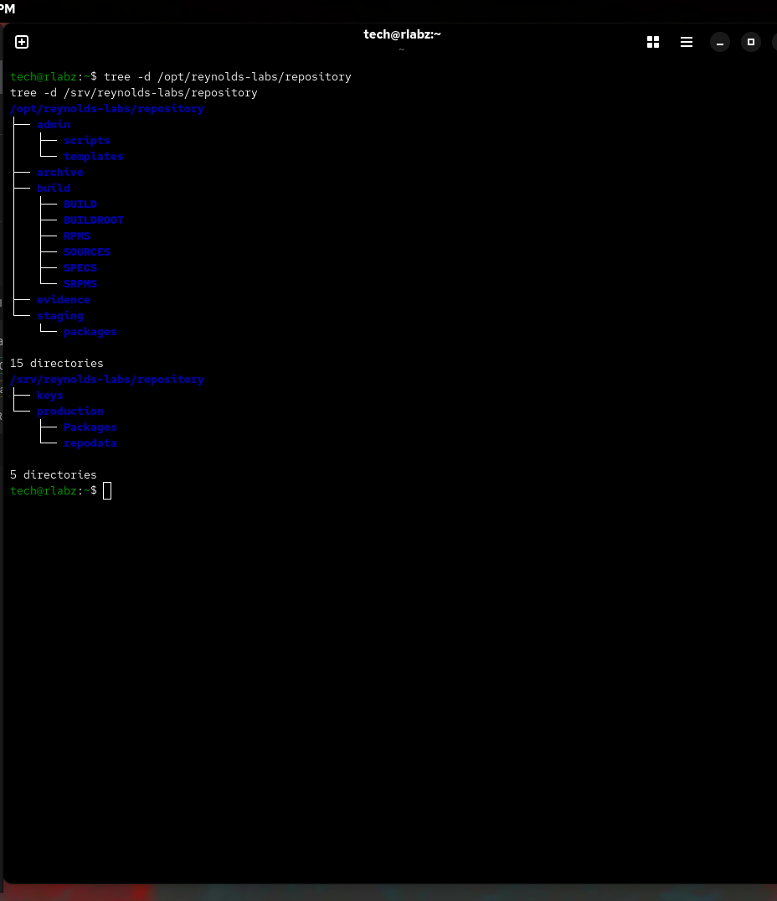

## Design Decisions

**Private-first distribution.** The repository is intended for internal lab systems rather than internet-wide exposure. Network reachability and firewall behavior are treated as explicit configuration and testing concerns.

**Separation of duties.** Build, staging, production, and signing assets have distinct purposes, making it easier to validate a package before publication.

**Group-managed administration.** The `rlab-repo` Linux group provides a basis for delegated access. SGID directory permissions can preserve group ownership as administrators create files.

**Package authenticity.** A dedicated Reynolds Labs signing identity allows verification of signed RPMs. A public signing key can be distributed to clients; the private signing key must remain protected and should not be published in this portfolio.

**RPM-native tooling.** Using `rpm`, `dnf`, `rpmbuild`, `createrepo_c`, and GnuPG demonstrates conventional Enterprise Linux package-management workflows.

**Reusable client testing.** The disposable Rocky Linux workstation from LAB002 provides a repeatable environment for testing package installations without permanently modifying its operating-system baseline.

## Build and Configuration

### 1. Repository filesystem and permissions

The repository tree was organized around build, staging, production, configuration, keys, and logs. A dedicated administration group was used for shared management.

Selected illustrative commands (not the complete implementation):

```bash
sudo groupadd -f rlab-repo
sudo install -d -m 2775 -g rlab-repo /opt/reynolds-labs/repository/build
sudo install -d -m 2775 -g rlab-repo /opt/reynolds-labs/repository/staging/packages
sudo install -d -m 2775 -g rlab-repo /srv/reynolds-labs/repository/production
```

The `2` in mode `2775` enables SGID inheritance on directories; group membership and effective ownership still require validation. The screenshot captures administration and permission checks.

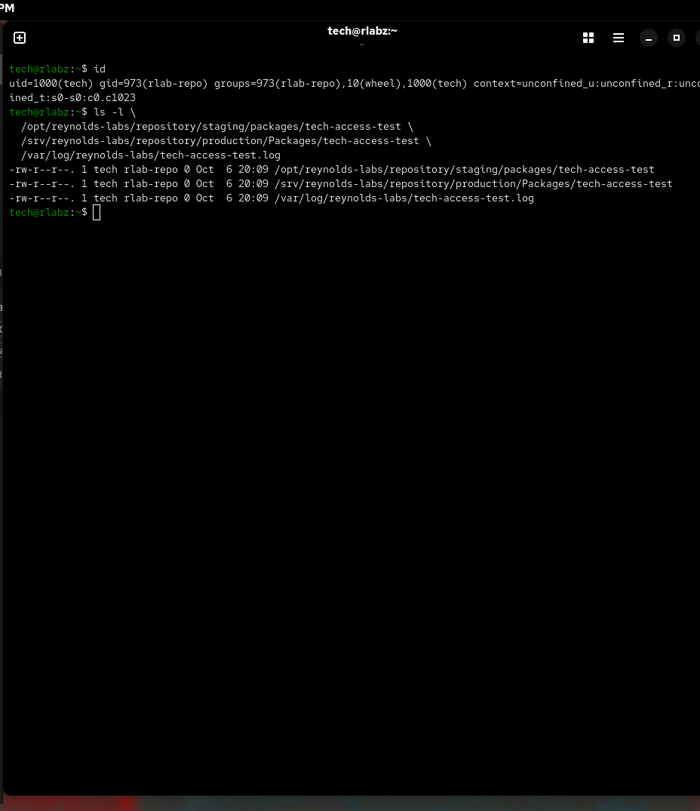

The package-management view provides additional evidence of the repository administration environment.

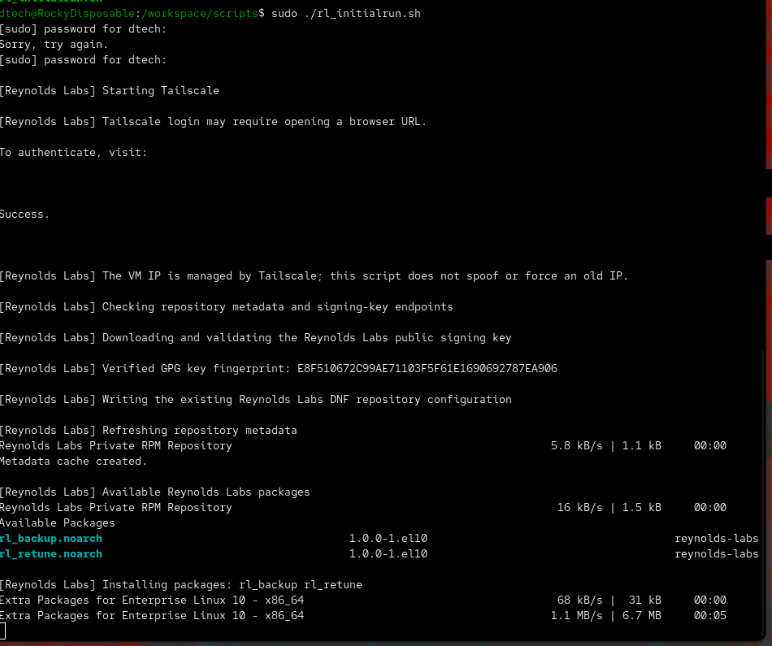

### 2. Repository metadata

The production tree holds packages in `Packages/` and repository metadata in `repodata/`.

Metadata can be generated after packages are staged and approved:

```bash
sudo createrepo_c /srv/reynolds-labs/repository/production
```

A client repository definition points DNF to the repository's configured internal publication endpoint or file-based location.

The specific network URL depends on the deployment and should not be assumed from this sample.

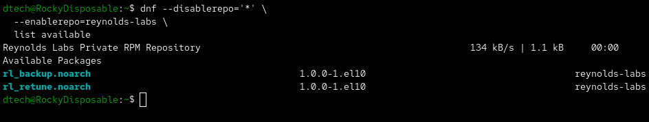

### 3. GPG signing identity

A dedicated **Reynolds Labs RPM Signing** RSA key was created for package signing.

Its public fingerprint is suitable for verification; private key material and recovery copies are intentionally excluded.

```bash
gpg --fingerprint 'Reynolds Labs RPM Signing'
```

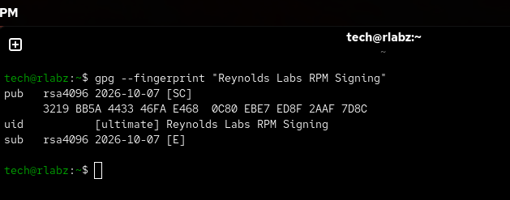

The package-signature workflow can be checked using:

```bash
rpm -Kv /path/to/package.rpm
```

The validation evidence shows RPM signature and digest checks.

This demonstrates package verification activity, but does not imply that every future release is automatically signed or that the complete distribution pipeline is automated.

An additional signing-key view documents the GPG identity used in the RPM workflow. It is included for operational context, not as evidence that private key material was published.

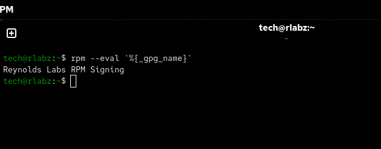

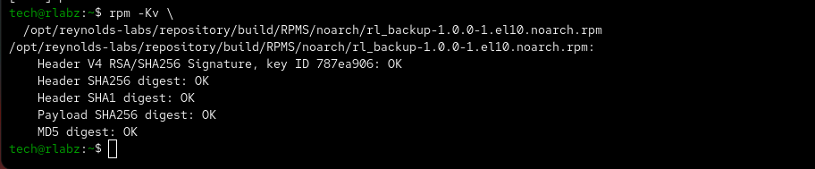

### 4. Reynolds Labs package targets

The repository distributes internal utilities, including:

**RL_Backup**

A Linux backup and recovery utility supporting backup creation, integrity verification, retention, and file restoration.

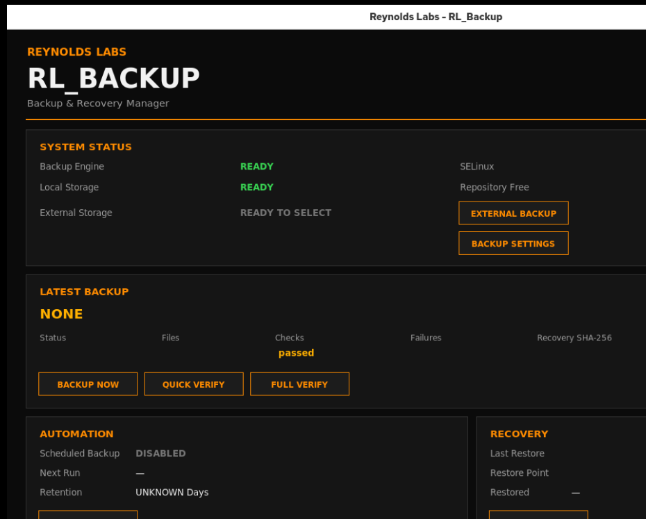

**ReTune**

A graphical Linux performance-management utility for switching between custom TuneD profiles.

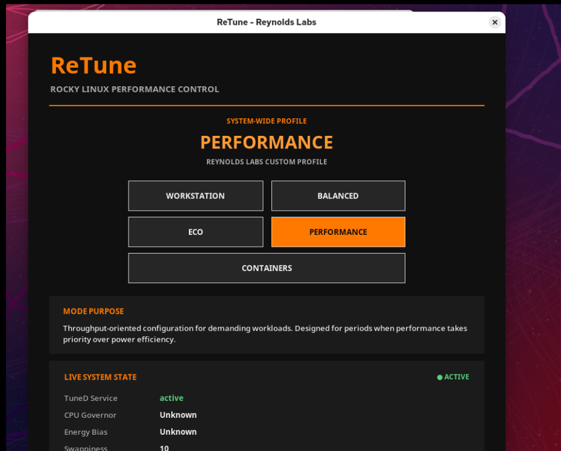

Both applications were successfully installed through DNF on the disposable Rocky Linux client.

The applications launched successfully, and basic functionality was tested.

Comprehensive application testing was outside the scope of LAB005.

The application screenshots illustrate the tools being distributed; they are not, by themselves, independent evidence of the DNF installation process.

## Network and Client Testing

The lab includes network-oriented checks against an internal repository endpoint.

Testing included HTTP header requests, repository-path inspection, and connectivity/firewall diagnostics.

These checks help distinguish a missing service, an unreachable network port, and an incorrect repository path.

For example, a client can inspect the expected repository metadata location with a HEAD request:

```bash
curl -I http://INTERNAL-REPO-HOST/path/to/repodata/repomd.xml
```

The URL above is intentionally a placeholder.

An HTTP response must be interpreted in context; connectivity alone does not prove that a DNF client can install a signed package.

The HTTP metadata check shows the repository publication path being tested separately from DNF package installation.

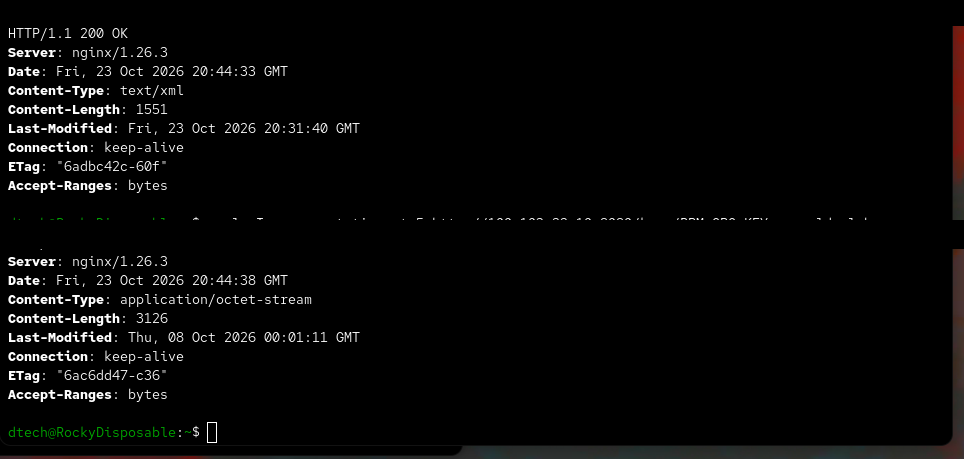

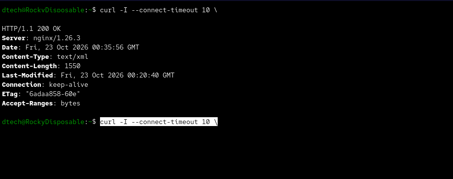

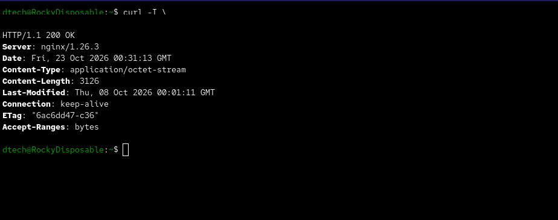

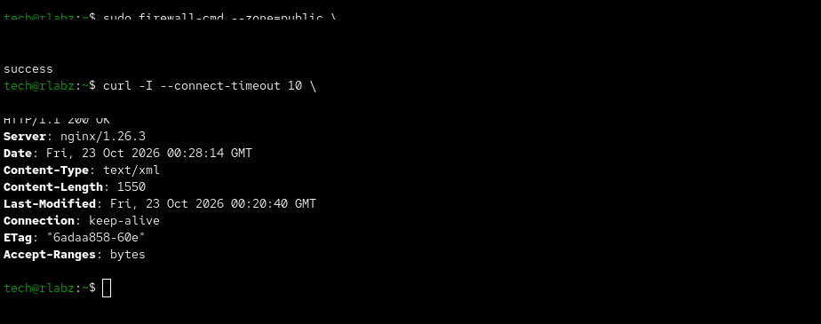

A further HTTP response check documents the repository endpoint response during connectivity validation.

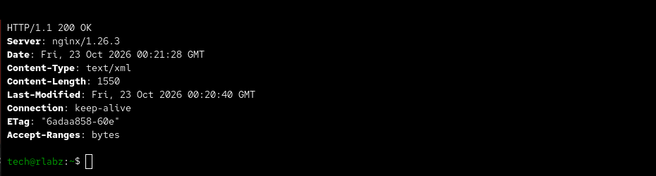

### Disposable Rocky Linux Client

The disposable Rocky Linux workstation developed in LAB002 was selected as the repository testing client.

This allowed the repository to be tested from a separate operating-system environment rather than relying exclusively on commands executed on the repository host.

Tailscale was installed on the disposable VM, and a private VPN connection workflow was configured for LAB005 and future Reynolds Labs repository testing.

The client was configured to connect to the private repository running on the Rocky Linux host.

Once connectivity and repository configuration were established, DNF was used to install RL_Backup and ReTune.

Both applications launched successfully, and basic functionality was verified.

This demonstrated that the repository could distribute custom Reynolds Labs software to a separate Rocky Linux system.

The disposable workstation also provides an opportunity to repeat installation testing from a clean operating-system baseline in future projects.

## Troubleshooting and Iteration

Several aspects of the work required explicit validation rather than assuming a repository was ready simply because directories existed:

- **Permission model:** Checking that the repository administrator could work in the expected directories without making everything world-writable.
- **Signing verification:** Distinguishing a key's public identity from protected private-key material and checking package signatures independently.
- **Repository metadata:** Understanding how repository metadata is generated and consumed by DNF.
- **Repository endpoint:** Inspecting HTTP responses and repository paths instead of assuming that an active network service meant valid metadata was available.
- **Firewall and client reachability:** Separating tests performed on the repository host from tests performed by another machine.
- **VPN connectivity:** Establishing private connectivity between the disposable client and repository host.
- **Publication readiness:** Keeping application screenshots, package checks, and client-install results as separate evidence categories.

The repository required several components to work together before a successful installation could occur.

Completing the client-side DNF installation was an important final validation step.

## Security and Safety

- The repository is designed for private lab distribution, not anonymous internet exposure.
- The signing key's **private material and passphrases are not included** in the portfolio.
- Group-based directory permissions support controlled administration.
- Package verification is performed using RPM tooling rather than trusting filenames alone.
- Published code is limited to selected command examples; no full repository automation or signing scripts are included.
- Network screenshots are sanitized to limit disclosure of private repository and VPN details.
- Private VPN connectivity is used for repository access from the disposable testing environment.

## Validation

| Validation area | Evidence and interpretation |
|---|---|
| Filesystem layout | Repository directories and separation of build/staging/production documented |
| Group permissions | Repository administration and permissions inspected |
| Signing identity | Dedicated RPM signing key and public fingerprint displayed |
| Package signature | RPM verification command output captured |
| Package targets | RL_Backup and ReTune identified as distribution targets |
| Repository endpoint | HTTP metadata/path and connectivity checks captured |
| Private VPN connectivity | Disposable Rocky Linux client connected to the private repository |
| End-to-end DNF installation | Completed — RL_Backup and ReTune were installed from the private repository on the disposable Rocky Linux client |
| Application launch | Both applications launched, and basic functionality was verified |
| Comprehensive application testing | Outside the scope of this lab |
| Fully automated signed release | Not implemented as part of this lab |

## Results

LAB005 successfully established a functional private Reynolds Labs RPM repository.

The completed project included repository directory architecture, delegated administration, repository metadata, a dedicated signing identity, package verification, and private network connectivity.

The disposable Rocky Linux workstation from LAB002 was used to connect to the repository through Tailscale.

Both RL_Backup and ReTune were successfully installed using DNF, launched, and checked for basic functionality.

This demonstrated that custom Reynolds Labs applications could be distributed to another Linux machine using conventional RPM/DNF package-management tools.

The repository was intentionally designed to support future applications and additional testing environments.

Fully automated package publishing, client onboarding, update validation, and rollback testing remain opportunities for future development rather than requirements for completing this lab.

## Reflection

This lab reinforced that an RPM repository is more than a folder of `.rpm` files.

A maintainable design also needs trusted signing, metadata, filesystem authorization, reliable client access, and reproducible testing.

The most valuable operational lesson was understanding how these individual components work together to deliver software to another Linux system.

Successfully installing Reynolds Labs applications through DNF demonstrated the practical value of the repository beyond its initial configuration.

## What This Lab Demonstrates

Practical experience with Enterprise Linux package management, RPM repositories, GPG signing, Linux groups and SGID permissions, repository metadata, private networking, DNF client configuration, software installation, and evidence-based validation.

The project also demonstrates how separate infrastructure and application labs can be integrated into a reusable environment.

The work is intentionally lab-scale and does not claim production-scale deployment or fully automated software releases.

## Evidence

The [`screenshots/`](screenshots/) directory contains the curated screenshots used in this case study.

Some additional original screenshots were omitted because they were redundant or related to separate VM/RDP troubleshooting.

The screenshots document repository infrastructure, signing, configuration, and connectivity testing.

The completed DNF installations and basic application launch tests are also described in the project documentation.

## Disclosure

This is an independently built Reynolds Labs portfolio project.

No private signing keys, passwords, proprietary employer data, production customer information, or complete internal automation scripts are included.

Commands are selected educational examples, not a full turnkey deployment.

---

## After Thoughts — Behind the Build

After building my first Reynolds Labs utility, I started thinking about how cool it would be to have my own software repository. Instead of manually transferring scripts and applications between machines, I could build an entire collection of tools and make them available through a private repository. The idea of creating my own software distribution system was exciting, especially knowing that I could continue adding applications as Reynolds Labs expanded. I had no previous experience creating an RPM repository, so I spent some time researching how they worked and used AI-assisted scripting to help develop the initial design and understand the components involved. The original concept was fairly straightforward: build the repository, connect another Linux machine to it, and see whether I could install my own applications using DNF.

Getting everything configured took more time than I initially expected. I designed the repository with separate staging and production directories, created a dedicated `rlab-repo` group, and configured SGID permissions to manage access. Most of the directory and permission configuration made sense, but I got a little lost when working with repository metadata. I understood the general concept, but learning how the metadata was generated and how DNF used it took some additional effort. I also created a dedicated GPG signing identity called *Reynolds Labs RPM Signing*. I had worked with GPG in the past, although I certainly wasn't an expert. The signing process made sense once I worked through it, but it also reinforced the importance of deciding how to protect and back up cryptographic keys when building this type of infrastructure.

One thing I enjoy doing with Reynolds Labs is finding ways to connect different projects rather than treating every lab as something completely independent. I thought my disposable Rocky Linux workstation from LAB002 would be an excellent testing environment for the repository. I installed Tailscale on the disposable VM, configured the VPN connection, and connected it to the private repository running on my Rocky Linux host. Once the components were configured, everything worked surprisingly well. I successfully installed both Reynolds Labs applications through DNF, launched them, and verified their basic functionality. I didn't perform comprehensive application testing because that was outside the scope of this particular lab. The goal was to demonstrate that my software could be distributed and installed through the repository. Seeing `dnf install` successfully install RL_Backup from my own repository was particularly satisfying. I had gone from building a standalone backup utility to distributing that same application through infrastructure I had created myself.

This project took longer than expected, but I deliberately designed it to be versatile and expandable. As I develop more applications, scripts, and system configurations, I can continue adding them to the repository and making them available to my future virtual machines and test systems. It also creates opportunities to demonstrate additional Linux automation through package-building scripts and repeatable deployment workflows. I specifically wanted LAB005 to be the last of my original five projects because it connects several of the earlier labs and brings their different components together. Rather than having five unrelated experiments, I now have a foundation where the projects can support one another. Of the original five labs, I consider this one the most challenging and the most rewarding.

Looking ahead, I would like to introduce more automation into the package-building, signing, publishing, and installation processes. I also want to continue developing new tools and finding ways to expand the repository's usefulness. For now, it serves as a private collection of Reynolds Labs software for my own virtual machines and test environments, which is exactly what I originally wanted. The best part is that the project doesn't really have a fixed endpoint. As Reynolds Labs grows, the repository can grow alongside it. Looking back at the original five labs, I'm happy I chose this project as the final one because it brings together so much of what I was trying to accomplish when I started building the portfolio.

---

## Reynolds Labs — Lab Assessment

**Technical Skill:** 3/5 — Advanced  
**Fun Factor:** 5/5 — One of My Favorites

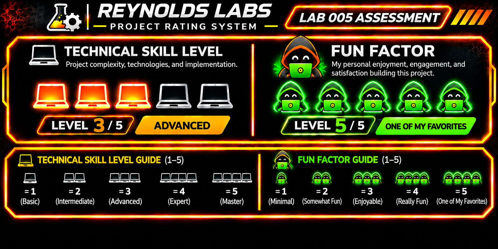
